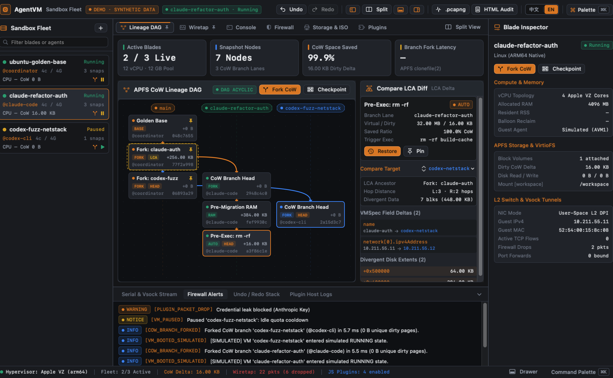

**English** | **[简体中文](README.zh-CN.md)**

# AgentVM `v1.2.0`

> **Current Status (M0 — Baseline Honesty & Crash Fixes)**: APFS Copy-on-Write (`clonefile(2)`) sparse disk & snapshot lineage management, SQLite WAL workspace persistence, pure-Swift NoCloud `cidata` ISO-9660 generation, and sandboxed `JavaScriptCore` policy evaluation work locally today. Ethernet/IPv4/DNS/TLS frame dissection and `.pcapng` reading/writing exist as a library (`AgentVMNetSwitch`, covered by unit tests); neither the CLI nor the desktop UI can open a capture file yet. Real Linux image download, `VZVirtualMachine` guest boot, and live `AF_VSOCK` command execution are in development (M1–M3). No guest can be booted in this build, so there is no guest networking of any kind yet; user-space egress firewall enforcement and live VM packet capture are scheduled for M5.

[](https://github.com/zxu756/AgentVM/releases)
[-141517)](https://github.com/zxu756/AgentVM)
[](https://swift.org)
[](README.zh-CN.md)
[](LICENSE)

`AgentVM` is a macOS (Apple Silicon) workspace manager and APFS Copy-on-Write disk & snapshot lineage tool with a CLI, a stdio MCP server and a desktop workbench, written in Swift 6, with live `中文 | EN` bilingual switching across the desktop UI and CLI (`--lang en` / `--lang zh`). It cannot boot a virtual machine yet, and the workbench's packet and firewall views have no real traffic to show before M5.

By default, launching the desktop app or initializing a `.agentvm` workspace starts completely empty (0 VMs, 0 packets, 0 alerts) and never fabricates guest execution or telemetry:

- Creating a VM in M0 provisions a sparse GPT disk image and a NoCloud `cidata` ISO-9660 seed image, without a guest OS installed.
- Running `agentvm up <vm>` or `agentvm exec <vm> -- ...` on an unbooted/empty disk exits non-zero with an explicit error instead of silently falling back to a simulator.
- Host-side protocol & wire-session simulation is available only when explicitly requested via `--backend simulation` or in UI demonstration mode (`--demo` / **Load Demo**, labeled `[DEMO]`). Every output of a simulation run is marked: text lines are prefixed with `SIMULATED:`, `ps --json` and MCP `agentvm_list_fleet` records carry `"simulated": true`, `export-hcl` gets a `# SIMULATED:` comment line, and exported `.pcapng` and HTML files are marked inside the file.
- State the simulator leaves in a workspace stays marked for everyone who reads it later: a default `agentvm ps` prints `SIMULATED:running`, `ps --json` shows `"simulated": true` next to `"state": "running"`, and the default backend never acts on it (`up`, `exec`, `pause` discard the simulated state and fail as they would on a VM that never ran).
- Unmeasured CPU and memory fields are displayed as `—`.
- There is no guest networking yet, because no guest can be booted. VM records are configured for the user-space switch, which has no route to the outside network before M5; `agentvm policy strict|airgap` only selects and saves a preset and enforces nothing on real traffic. The Wiretap and Firewall views display `Not connected to live traffic yet (scheduled for M5)`.
- `agentvm doctor` reports whether the running executable actually carries the `com.apple.security.virtualization` entitlement. A plain `swift build` binary does not, and `doctor` says so instead of printing `PASS`.

---

## Status & Milestone Roadmap

| Milestone | Capability | Status |
|---|---|---|
| **M0** | Honest baseline: plain `agentvm ps` fix, real `clonefile(2)` probe and real entitlement check in `doctor`, empty default UI, explicit `--backend simulation` with `SIMULATED` markers on every output and on stored state, `[DEMO]` gating, `—` for unmeasured telemetry, preemptive `JavaScriptCore` hook watchdog | **Implemented** |
| **M1** | `agentvm image pull debian-12-bookworm-arm64` + single-command `agentvm run` booting a real Linux kernel/rootfs on `VZVirtualMachine` with live `AF_VSOCK` stdout/stderr/exit-code streaming and `/proc` telemetry | Planned |
| **M2** | Per-VM background daemon so `up`, `exec`, `pause`, `resume`, and `halt` work across separate CLI invocations | Planned |
| **M3** | Measured APFS CoW branching (`branch`) and snapshot restore (`snapshot` / `restore`) against real Linux root filesystems (measured latency and dirty-byte delta to be reported after M3) | Planned |
| **M4** | Desktop UI wired end-to-end to real running VMs, live serial console, and workspace state | Planned |
| **M5** | Live guest NIC attachment to the user-space Layer-2 switch, outbound DNS/TLS SNI policy enforcement, and real guest `.pcapng` capture | Planned (under evaluation) |

---

## Verified CLI Quick Start

Build the `AgentVM` executable from source and run all commands against an isolated `.agentvm` workspace. Lines starting with `# ->` show the documented result; `...` stands for text that varies (IDs, paths, timings). `Scripts/acceptance/readme-commands.sh` reads this block and fails if a command or one of these results no longer matches.

```bash
swift build --product AgentVM
alias agentvm="$(pwd)/.build/debug/AgentVM"

# 1. Host readiness check (live APFS clonefile(2) probe on the workspace volume; reads this executable's virtualization entitlement)
agentvm --lang en --workspace ./demo-check.agentvm doctor
# -> APFS clonefile(2) : PASS (verified via live clonefile(2) probe)

# 2. Initialize an empty workspace and create an empty sparse GPT VM record
agentvm --lang en --workspace ./demo-check.agentvm init
# -> Initialized workspace 'demo-check' (...) at ...
agentvm --lang en --workspace ./demo-check.agentvm create sandbox-a
# -> Created VM 'sandbox-a' (...) with root snapshot ... (empty sparse GPT disk, no guest OS installed)

# 3. List VMs in table or JSON form (unmeasured CPU/RAM shown as —)
agentvm --lang en --workspace ./demo-check.agentvm ps
# -> sandbox-a ... stopped
agentvm --lang en --workspace ./demo-check.agentvm ps --json
# -> "state" : "stopped"

# 4. Fork an APFS Copy-on-Write disk branch, list snapshots, inspect plugins, and export HCL
agentvm --lang en --workspace ./demo-check.agentvm branch sandbox-a sandbox-b --no-boot
# -> Forked CoW branch 'sandbox-b' (...) in ... ms from snapshot ...
agentvm --lang en --workspace ./demo-check.agentvm snapshot list
# -> Golden Base (sandbox-a) ... Branch Fork -> sandbox-b ... CoW Head (sandbox-b)
agentvm --lang en --workspace ./demo-check.agentvm plugin
# -> builtin.secret-leak-guard ... ENABLED
agentvm --lang en --workspace ./demo-check.agentvm export-hcl
# -> sandbox_vm "sandbox-a" ... sandbox_vm "sandbox-b"

# 5. Booting or executing on an empty disk fails honestly (non-zero exit code)
agentvm --lang en --workspace ./demo-check.agentvm up sandbox-a
# -> exits non-zero: [ERR_NO_BOOTABLE_SYSTEM] VM 'sandbox-a' has no bootable guest OS or kernel on its disk...
agentvm --lang en --workspace ./demo-check.agentvm exec sandbox-a -- uname -a
# -> exits non-zero: [ERR_NO_BOOTABLE_SYSTEM] VM 'sandbox-a' has no bootable guest OS or kernel on its disk...

# 6. Explicit host-side simulation requires --backend simulation and prefixes every line with SIMULATED:
#    (the simulator answers with a fixed hostname, "agent-sandbox", whatever the VM is called)
agentvm --lang en --workspace ./demo-check.agentvm --backend simulation exec sandbox-a -- uname -a
# -> SIMULATED: Linux agent-sandbox 6.8.0-agentvm-arm64 #1 SMP PREEMPT_DYNAMIC aarch64 GNU/Linux

# 7. What the simulator left behind stays marked for the default backend, in text and in JSON
agentvm --lang en --workspace ./demo-check.agentvm ps
# -> sandbox-a ... SIMULATED:running
# -> SIMULATED: 1 VM state(s) above were written by --backend simulation; no real guest is running.
agentvm --lang en --workspace ./demo-check.agentvm ps --json
# -> "simulated" : true
agentvm --lang en --workspace ./demo-check.agentvm --backend simulation halt sandbox-a
# -> SIMULATED: VM 'sandbox-a' (...) -> stopped
```

Unknown options are errors, not ignored: `agentvm ps --bogus` exits with code 2.

Every command also supports Simplified Chinese output via `--lang zh` (or `AGENTVM_LANG=zh`):

```bash
agentvm --lang zh --workspace ./demo-check.agentvm doctor
agentvm --lang zh --workspace ./demo-check.agentvm ps
```

---

## Desktop Workbench Preview (`[DEMO]` Synthetic Dataset)

> **Demonstration Data Notice**: All screenshots below were rendered in explicit `--demo` mode (`DEMO · SYNTHETIC DATA`). The VMs, CoW branches, Ethernet/TLS frames, and policy counters shown in these captures are synthetic demonstration fixtures, not captures from live running guest VMs. Launching `AgentVM` normally opens an empty workspace. These images were rendered before the status bar was corrected: in them it reads `Hypervisor: Apple VZ`, while the demonstration fleet runs on the host-side simulator. Current builds show `Hypervisor: SIMULATED` in demonstration mode and `SIMULATED · Running` on each demonstration VM; the images have not been re-rendered yet.

### Overview & Snapshot Lineage DAG (`[DEMO]` Synthetic Data)


### Offline Packet Dissector & Hex View (`[DEMO]` Synthetic Data — Live Traffic Scheduled for M5)


### APFS Sparse Extent Map & NoCloud ISO-9660 Inspector (`[DEMO]` Synthetic Data)


### Policy Rule Simulator & JavaScriptCore Plugin Host (`[DEMO]` Synthetic Data — Live Traffic Scheduled for M5)


---

## Testing & Verification Scripts

```bash
# Scoped unit tests for specific SwiftPM modules
./Scripts/test.sh scope AgentVMStore AgentVMHypervisor AgentVMCLIAndMCP

# Replay all documented README commands in a temporary workspace
./Scripts/acceptance/readme-commands.sh

# Run full M0 acceptance suite (20x cold CLI stability, honest failure checks, simulation-marker checks for CLI and MCP,
# doctor entitlement check, policy persistence, clean repo check, default-UI empty-state check).
# No script launches the desktop UI: the UI row is a windowless ViewModel test.
./Scripts/test.sh milestone 0
```

---

## Building the macOS App Bundle

```bash
./Scripts/build-app.sh
# Launch empty default workbench (0 VMs, 0 packets, 0 alerts):
open build/AgentVM.app
# Or launch with synthetic demonstration data explicitly enabled:
./build/AgentVM.app/Contents/MacOS/AgentVM --demo
```

`Scripts/build-app.sh` ad-hoc signs `AgentVM.app` with `com.apple.security.virtualization` on Apple Silicon (`macOS 14+`). The `.build/debug/AgentVM` binary produced by `swift build` is not signed with that entitlement; `agentvm doctor` reports this.

---

## License

Released under the [MIT License](LICENSE).
