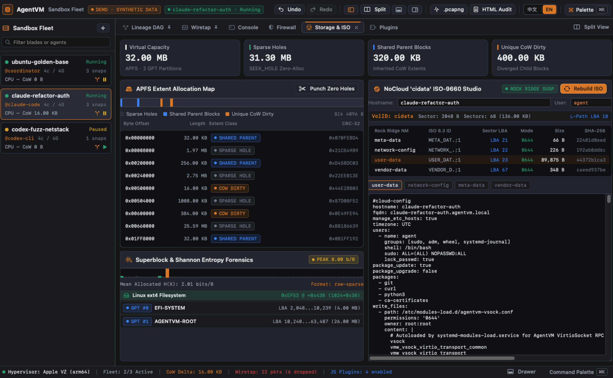

**English** | **[简体中文](README.zh-CN.md)**

# AgentVM `v1.1.0`

> **Current Status (M0 — Baseline Honesty & Crash Fixes)**: APFS Copy-on-Write (`clonefile(2)`) sparse disk & snapshot lineage management, SQLite WAL workspace persistence, pure-Swift NoCloud `cidata` ISO-9660 generation, offline Ethernet/IPv4/DNS/TLS packet dissection (`.pcapng`), and sandboxed `JavaScriptCore` policy evaluation work locally today. Real Linux image download, `VZVirtualMachine` guest boot, and live `AF_VSOCK` command execution are in development (M1–M3). User-space egress firewall enforcement and live VM packet capture are not connected to guest traffic yet (scheduled for M5).

[](https://github.com/zxu756/AgentVM/releases)
[-141517)](https://github.com/zxu756/AgentVM)
[](https://swift.org)
[](README.zh-CN.md)
[](LICENSE)

`AgentVM` is a macOS (Apple Silicon) workspace manager, APFS Copy-on-Write disk & snapshot lineage tool, and protocol inspection workbench written in Swift 6, with live `中文 | EN` bilingual switching across the desktop UI and CLI (`--lang en` / `--lang zh`).

By default, launching the desktop app or initializing a `.agentvm` workspace starts completely empty (0 VMs, 0 packets, 0 alerts) and never fabricates guest execution or telemetry:

- Creating a VM in M0 provisions a sparse GPT disk image and a NoCloud `cidata` ISO-9660 seed image, without a guest OS installed.
- Running `agentvm up <vm>` or `agentvm exec <vm> -- ...` on an unbooted/empty disk exits non-zero with an explicit error instead of silently falling back to a simulator.
- Host-side protocol & wire-session simulation is available only when explicitly requested via `--backend simulation` (every output line is prefixed with `SIMULATED:`) or in UI demonstration mode (`--demo` / **Load Demo**, labeled `[DEMO]`).
- Unmeasured CPU and memory fields are displayed as `—`.
- Until M5 is completed, guest networking relies on macOS system NAT with no outbound egress enforcement; the Wiretap and Firewall views display `Not connected to live traffic yet (scheduled for M5)`.

---

## Status & Milestone Roadmap

| Milestone | Capability | Status |
|---|---|---|
| **M0** | Honest baseline: plain `agentvm ps` fix, real `clonefile(2)` probe in `doctor`, empty default UI, explicit `--backend simulation` (`SIMULATED:`) & `[DEMO]` gating, `—` for unmeasured telemetry, preemptive `JavaScriptCore` hook watchdog | **Implemented on `m0/honest`** |
| **M1** | `agentvm image pull debian-12-bookworm-arm64` + single-command `agentvm run` booting a real Linux kernel/rootfs on `VZVirtualMachine` with live `AF_VSOCK` stdout/stderr/exit-code streaming and `/proc` telemetry | Planned |
| **M2** | Per-VM background daemon so `up`, `exec`, `pause`, `resume`, and `halt` work across separate CLI invocations | Planned |
| **M3** | Measured APFS CoW branching (`branch`) and snapshot restore (`snapshot` / `restore`) against real Linux root filesystems (measured latency and dirty-byte delta to be reported after M3) | Planned |
| **M4** | Desktop UI wired end-to-end to real running VMs, live serial console, and workspace state | Planned |
| **M5** | Live guest NIC attachment to the user-space Layer-2 switch, outbound DNS/TLS SNI policy enforcement, and real guest `.pcapng` capture | Planned (under evaluation) |

---

## Verified CLI Quick Start

Build the `AgentVM` executable from source and run all commands against an isolated `.agentvm` workspace:

```bash
swift build --product AgentVM
alias agentvm="$(pwd)/.build/debug/AgentVM"

# 1. Host readiness check (runs a live APFS clonefile(2) probe on the workspace volume)
agentvm --lang en --workspace ./demo-check.agentvm doctor

# 2. Initialize an empty workspace and create an empty sparse GPT VM record
agentvm --lang en --workspace ./demo-check.agentvm init
agentvm --lang en --workspace ./demo-check.agentvm create sandbox-a

# 3. List VMs in table or JSON form (unmeasured CPU/RAM shown as —)
agentvm --lang en --workspace ./demo-check.agentvm ps
agentvm --lang en --workspace ./demo-check.agentvm ps --json

# 4. Fork an APFS Copy-on-Write disk branch, list snapshots, inspect plugins, and export HCL
agentvm --lang en --workspace ./demo-check.agentvm branch sandbox-a sandbox-b --no-boot
agentvm --lang en --workspace ./demo-check.agentvm snapshot list
agentvm --lang en --workspace ./demo-check.agentvm plugin
agentvm --lang en --workspace ./demo-check.agentvm export-hcl

# 5. Booting or executing on an empty disk fails honestly (non-zero exit code)
agentvm --lang en --workspace ./demo-check.agentvm up sandbox-a
# -> exits non-zero: [ERR_NO_BOOTABLE_SYSTEM] VM 'sandbox-a' has no bootable guest OS or kernel on its disk...
agentvm --lang en --workspace ./demo-check.agentvm exec sandbox-a -- uname -a
# -> exits non-zero: [ERR_NO_BOOTABLE_SYSTEM] VM 'sandbox-a' has no bootable guest OS or kernel on its disk...

# 6. Explicit host-side simulation requires --backend simulation and prefixes every line with SIMULATED:
agentvm --lang en --workspace ./demo-check.agentvm --backend simulation exec sandbox-a -- uname -a
# -> SIMULATED: Linux sandbox-a 6.8.0-agentvm-arm64 #1 SMP PREEMPT_DYNAMIC aarch64 GNU/Linux
```

Every command also supports Simplified Chinese output via `--lang zh` (or `AGENTVM_LANG=zh`):

```bash
agentvm --lang zh --workspace ./demo-check.agentvm doctor
agentvm --lang zh --workspace ./demo-check.agentvm ps
```

---

## Desktop Workbench Preview (`[DEMO]` Synthetic Dataset)

> **Demonstration Data Notice**: All screenshots below were rendered in explicit `--demo` mode (`DEMO · SYNTHETIC DATA`). The VMs, CoW branches, Ethernet/TLS frames, and policy counters shown in these captures are synthetic demonstration fixtures, not captures from live running guest VMs. Launching `AgentVM` normally opens an empty workspace.

### Overview & Snapshot Lineage DAG (`[DEMO]` Synthetic Data)


### Offline Packet Dissector & Hex View (`[DEMO]` Synthetic Data — Live Traffic Scheduled for M5)


### APFS Sparse Extent Map & NoCloud ISO-9660 Inspector (`[DEMO]` Synthetic Data)


### Policy Rule Simulator & JavaScriptCore Plugin Host (`[DEMO]` Synthetic Data — Live Traffic Scheduled for M5)


---

## Testing & Verification Scripts

```bash
# Scoped unit tests for specific SwiftPM modules
./Scripts/test.sh scope AgentVMStore AgentVMHypervisor AgentVMCLIAndMCP

# Replay all documented README commands in a temporary workspace
./Scripts/acceptance/readme-commands.sh

# Run full M0 acceptance suite (20x cold CLI stability, honest failure checks, doctor probe, clean repo check, GUI empty-launch check)
./Scripts/test.sh milestone 0
```

---

## Building the macOS App Bundle

```bash
./Scripts/build-app.sh
# Launch empty default workbench (0 VMs, 0 packets, 0 alerts):
open build/AgentVM.app
# Or launch with synthetic demonstration data explicitly enabled:
./build/AgentVM.app/Contents/MacOS/AgentVM --demo
```

`Scripts/build-app.sh` ad-hoc signs `AgentVM.app` with `com.apple.security.virtualization` on Apple Silicon (`macOS 14+`).

---

## License

Released under the [MIT License](LICENSE).
