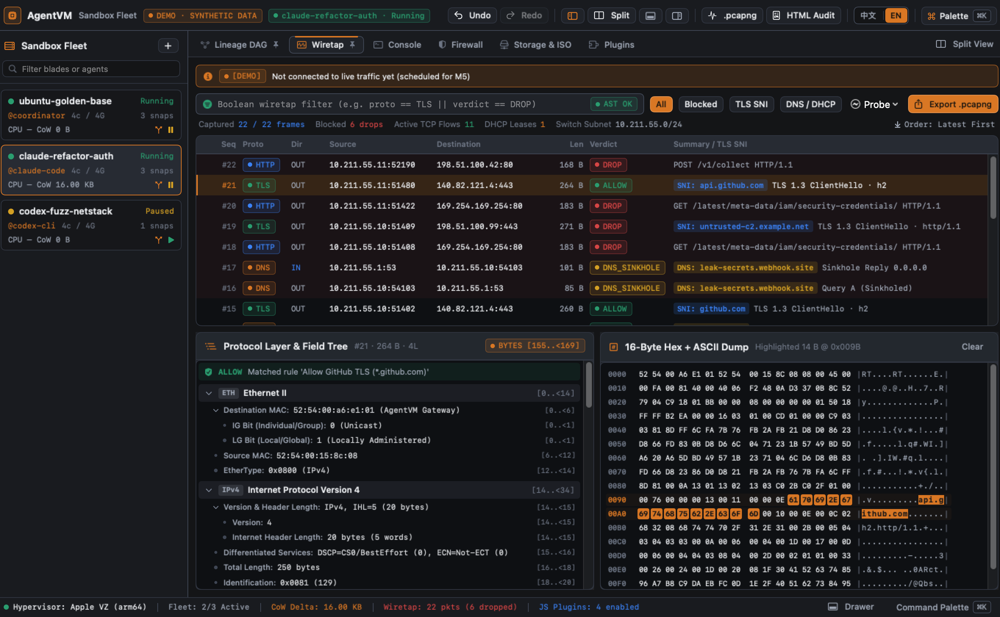

**English** | **[简体中文](README.zh-CN.md)**

# AgentVM `v1.4.0`

> Boot real Linux virtual machines for coding agents on a Mac: `agentvm exec` output comes from the guest itself, and forking a data-bearing VM takes **32.49 ms** (median wall-clock; nearest-rank p95 **58.26 ms**) and adds **0 B** of APFS private disk data bytes.
>
> *Measured on `2026-11-21` via `Scripts/acceptance/m3-branch-bench.sh` (`reports/m3-branch-bench.json`, reproduced by `AGENTVM_REAL_VM=1 ./Scripts/test.sh milestone 3 --record`) on `Mac16,10` (`Apple M4`, 10 cores, 16 GiB RAM), macOS `27.0.1` (`26A434`), APFS, with host `uptime` 1m/5m/15m load averages `1.77 2.24 2.39` at start and `1.98 2.53 2.51` at end, against an `8 GiB` `debian-12-bookworm-arm64` disk populated with `1 GiB` of random guest data (`/var/tmp/bench-data.bin`) and synced: 16 stopped `agentvm branch` invocations had a process wall-clock median of `32.49 ms` (min `26.48 ms`, p95 `58.26 ms`; CLI lock-to-SQLite median `13.52 ms`); 16 live running `agentvm branch` invocations via the workspace daemon had a wall-clock median of `115.31 ms` (min `102.90 ms`, p95 `164.82 ms`), pausing the parent guest for a median of `0.603 ms` (p95 `0.796 ms`; pre-pause guest `sync` median `1.004 ms`). Every newly cloned `.raw` / `.nvram` file reported `0 B` of unshared APFS private bytes via Darwin `getattrlist(ATTR_CMNEXT_PRIVATESIZE)` (excludes APFS filesystem metadata and newly generated `114688 B` `cidata` ISO + `70 B` `.machineid` files; host-wide `df -k` available-space delta across the 16 stopped / 16 live forks was `7256 KB` / `7936 KB`, an upper bound under concurrent host load). After booting each of the 32 children once to verify guest identities (all 5 persistent identity items pairwise distinct across all 33 VMs; 0 concurrent IPv4 collisions) and halting, median child root-disk APFS private bytes was `6131712 B` (`5.85 MiB`, p95 `6922240 B` / `6.60 MiB`).*

> **Current Status (M3 — APFS CoW Branching, Guest Identity Re-Seeding & Live Snapshots)**: APFS Copy-on-Write (`clonefile(2)`) disk branching (`branch`), snapshot capture (`snapshot`), and rollback (`restore`) work on both stopped and live running `VZVirtualMachine` instances, alongside SQLite WAL workspace persistence, pure-Swift NoCloud `cidata` ISO-9660 generation, and sandboxed `JavaScriptCore` policy evaluation. Ethernet/IPv4/DNS/TLS frame dissection and `.pcapng` reading/writing exist as a library (`AgentVMNetSwitch`, covered by unit tests); neither the CLI nor the desktop UI can open a capture file yet. `agentvm image pull debian-12-bookworm-arm64` downloads a pinned Debian 12 arm64 cloud image and verifies its SHA-512; `agentvm run <vm> -- <cmd>` runs a one-shot command on `VZVirtualMachine` and shuts the guest down; and a per-workspace background daemon (`daemon start|status|stop`, `events`) holds running `VZVirtualMachine` instances across separate CLI invocations so `up`, `exec` (concurrent `AF_VSOCK` stdout/stderr/exit-code streaming with `SIGINT`/`SIGTERM` cancellation on v2 guests; stdin is `/dev/null`), `pause`, `resume`, `halt`, `branch`, `snapshot`, and `restore` operate real guests and report live guest `/proc` CPU, memory, and uptime heartbeats plus APFS private bytes in `ps`. Booting needs a binary carrying `com.apple.security.virtualization`, which a plain `swift build` binary lacks. MCP `agentvm_capture_snapshot`, `agentvm_fork_cow_branch`, and `agentvm_restore_snapshot` route daemon-held VMs through the workspace daemon, while MCP lifecycle/`exec` tools and the desktop UI remain read-only against daemon-held VMs until M4; guest networking uses system NAT with no egress enforcement or live packet capture until M5.

[](https://github.com/zxu756/AgentVM/releases)
[-141517)](https://github.com/zxu756/AgentVM)
[](https://swift.org)
[](README.zh-CN.md)
[](LICENSE)

`AgentVM` is a macOS (Apple Silicon) workspace manager and APFS Copy-on-Write disk & snapshot lineage tool with a CLI, a stdio MCP server and a desktop workbench, written in Swift 6, with live `中文 | EN` bilingual switching across the desktop UI and CLI (`--lang en` / `--lang zh`). Persistent real VMs are held by one background daemon per workspace (`agentvm up` / `exec` / `pause` / `resume` / `halt` / `branch` / `snapshot` / `restore`), one-shot VMs run via `agentvm run`, and the workbench's packet and firewall views have no real traffic to show before M5.

By default, launching the desktop app or initializing a `.agentvm` workspace starts completely empty (0 VMs, 0 packets, 0 alerts) and never fabricates guest execution or telemetry:

- Creating a VM provisions a sparse GPT disk image and a NoCloud `cidata` ISO-9660 seed image. Without `--image` no guest OS is installed; with `--image debian-12-bookworm-arm64` the root disk is an APFS `clonefile(2)` clone of the cached image (falling back to a full copy with a stderr notice on non-APFS volumes). Disk space columns in `ps` and `snapshot list` report unshared APFS private bytes via `getattrlist(ATTR_CMNEXT_PRIVATESIZE)` rather than full-disk block comparisons.
- **Per-child guest identity on `branch`**: Forking a VM generates a fresh per-child NoCloud `cidata` ISO (`isos/<child>-<vmID>-cidata.iso`) with `instance-id` set to the child's VM ID, RFC 1123-sanitized `hostname` / `local-hostname` / `fqdn`, `dhcp-identifier: mac` in `network-config`, `/workspace` creation preserved in `bootcmd`, and a `cloud-init-per instance avm-machine-id` `bootcmd` that regenerates `/etc/machine-id` (and `/var/lib/dbus/machine-id`) on first boot while `cloud-init` regenerates SSH host keys and assigns a new MAC and `VZGenericMachineIdentifier`. Children stay `stopped` by default (`--no-boot`); passing `--boot` runs `up` preflight checks before creating the child and boots it via the workspace daemon. Restoring a child back to its pre-first-boot `CoW Head` snapshot causes `cloud-init` to treat the next boot as a new instance again and regenerate `machine-id` and SSH host keys.
- **Disk-only CoW forks & live snapshots (why memory-state forks are omitted)**: Live `branch` and `snapshot` on a running VM run guest `/bin/sync` over `AF_VSOCK` (30 s timeout), `pause` the VM for a few milliseconds to `clonefile(2)` the root disk (and EFI NVRAM on `branch`), `resume` immediately, and record a `live-disk` snapshot plus a `VM_PAUSED_FOR_SNAPSHOT` event with the exact pause duration. Memory-state (`saveMachineStateTo` / `restoreMachineStateFrom`) forks are intentionally not used: Apple's `Virtualization.framework` rejects restoring saved machine state if either the NIC MAC address or `VZGenericMachineIdentifier` differs (`VZErrorDomain` `invalid argument`), which would force every forked child to share the parent's MAC, DHCP IPv4 lease, hostname, and `machine-id`, preventing parent and child from running together.
- **Pre-restore safety snapshots & live rollback**: Every `agentvm restore <snapshot-id>` automatically clones the current root disk into a `cold-disk` snapshot titled `auto: before restore <snapshot-id>` and prints its ID before swapping the root disk, so uncommitted disk changes are never silently lost. On a running VM, the workspace daemon gracefully halts the guest (30 s timeout before force-stop), captures the pre-restore snapshot, atomically swaps the root disk while keeping the VM's `cidata` ISO, MAC, and identity unchanged, and boots the VM back up until `guestd` reconnects.
- **Automatic checkpoints before destructive `exec` commands**: Before running a guest command matched by the built-in destructive-command guard (such as `rm -rf`, `apt-get install`, `mkfs`, or `dd of=/dev/...`) on a running VM, the daemon automatically captures a live `auto-pre-cmd` (`autoPreCommandCheckpoint`) disk snapshot using the same `sync` → `pause` → `clonefile(2)` → `resume` path. Note that VM and snapshot deletion commands are not implemented yet (scheduled for M4), so repeated branching or checkpoints accumulate snapshot files in the workspace (`0 B` private bytes initially, growing as blocks diverge).
- Running `agentvm up <vm>` on an empty disk, or `agentvm exec <vm> -- ...` on an empty disk or a VM that is not running, exits non-zero with an explicit error instead of silently falling back to a simulator (a failed `up` or `branch --boot` preflight does not start a background daemon). `agentvm up` on a stopped VM that has a guest OS boots it. `agentvm run` on an empty disk exits 125.
- One background daemon per workspace (`<workspace>/run/daemon.sock`, started on demand by `up`, `branch --boot`, or `daemon start` via double-fork `setsid`, not `launchd`) holds running VMs. Logging out of macOS or rebooting the host is **not** guaranteed to preserve running VMs; if the daemon exits or is killed, VMs exit and subsequent reads reconcile stale `running` records to `stopped` (`VM_RUNTIME_LOST`).
- The guest agent script (`agentvm-guestd.py` v2) is written into the guest via `cloud-init` when a new VM or a newly forked `branch` child boots for the first time. VMs created before M2 themselves keep the older `1.0.0` guest script until recreated from `--image debian-12-bookworm-arm64` (though children forked from them via `branch` receive the v2 script on first boot).
- Host-side protocol & wire-session simulation is available only when explicitly requested via `--backend simulation` or in UI demonstration mode (`--demo` / **Load Demo**, labeled `[DEMO]`). Every output of a simulation run is marked: text lines are prefixed with `SIMULATED:`, `ps --json` and MCP `agentvm_list_fleet` records carry `"simulated": true`, `export-hcl` gets a `# SIMULATED:` comment line, and exported `.pcapng` and HTML files are marked inside the file.
- State the simulator leaves in a workspace stays marked for everyone who reads it later: a default `agentvm ps` prints `SIMULATED:running`, `ps --json` shows `"simulated": true` next to `"state": "running"`, and the default backend never acts on it (`up`, `exec`, `pause` discard the simulated state and fail as they would on a VM that never ran).
- Unmeasured or stale CPU and memory fields (no heartbeat within 15 seconds, paused, or stopped) are displayed as `—`.
- A guest started with `agentvm up` or `agentvm run` uses the system NAT, and nothing controls its egress before M5: `agentvm policy strict|airgap` only selects and saves a preset and enforces nothing on real traffic, and with `airgap` selected `agentvm up` exits 1 and `agentvm run` exits 125 because booting without a network is not possible before M5. The user-space switch has no route to the outside network before M5. The Wiretap and Firewall views display `Not connected to live traffic yet (scheduled for M5)`.
- `agentvm doctor` reports whether the running executable actually carries the `com.apple.security.virtualization` entitlement. A plain `swift build` binary does not, and `doctor` says so instead of printing `PASS`.

---

## Status & Milestone Roadmap

| Milestone | Capability | Status |
|---|---|---|
| **M0** | Honest baseline: plain `agentvm ps` fix, real `clonefile(2)` probe and real entitlement check in `doctor`, empty default UI, explicit `--backend simulation` with `SIMULATED` markers on every output and on stored state, `[DEMO]` gating, `—` for unmeasured telemetry, preemptive `JavaScriptCore` hook watchdog | **Implemented** |
| **M1** | `agentvm image pull debian-12-bookworm-arm64` + single-command `agentvm run` booting a real Linux kernel/rootfs on `VZVirtualMachine` with live `AF_VSOCK` stdout/stderr/exit-code streaming | **Implemented** |
| **M2** | One background daemon per workspace so `up`, `exec`, `pause`, `resume`, `halt`, `daemon`, and `events` work across separate CLI invocations, plus live guest `/proc` CPU, memory, and uptime telemetry | **Implemented** |
| **M3** | Stopped & live APFS CoW branching (`branch` / `branch --boot`), per-child `cidata` guest identity re-seeding, live `sync`+`pause` snapshots (`snapshot`), pre-restore safety snapshots & live rollback (`restore`), pre-destructive `exec` auto-checkpoints, and APFS private-bytes accounting (`32.49 ms` stopped fork median, `115.31 ms` live fork median, `0 B` cloned private bytes) | **Implemented** |
| **M4** | Desktop UI and full MCP lifecycle/`exec` wired as clients of the workspace daemon, VM/snapshot deletion (`rm`), directory sharing, port forwarding, `exec` stdin streaming, and interactive terminal | Planned |
| **M5** | Live guest NIC attachment to the user-space Layer-2 switch, outbound DNS/TLS SNI policy enforcement, and real guest `.pcapng` capture | Planned (under evaluation) |

---

## Verified CLI Quick Start

Build the `AgentVM` executable from source and run all commands against an isolated `.agentvm` workspace. Lines starting with `# ->` show the documented result; `...` stands for text that varies (IDs, paths, timings). `Scripts/acceptance/readme-commands.sh` reads this block and fails if a command or one of these results no longer matches.

```bash
swift build --product AgentVM
alias agentvm="$(pwd)/.build/debug/AgentVM"

# 1. Host readiness check (live APFS clonefile(2) probe on the workspace volume; reads this executable's virtualization entitlement)
agentvm --lang en --workspace ./demo-check.agentvm doctor
# -> APFS clonefile(2) : PASS (verified via live clonefile(2) probe)

# 2. Initialize an empty workspace and create an empty sparse GPT VM record
agentvm --lang en --workspace ./demo-check.agentvm init
# -> Initialized workspace 'demo-check' (...) at ...
agentvm --lang en --workspace ./demo-check.agentvm create sandbox-a
# -> Created VM 'sandbox-a' (...) with root snapshot ... (empty sparse GPT disk, no guest OS installed)

# 3. List VMs in table or JSON form (unmeasured CPU/RAM shown as —; APFS_PRIVATE reports unshared clone bytes)
agentvm --lang en --workspace ./demo-check.agentvm ps
# -> sandbox-a ... stopped
agentvm --lang en --workspace ./demo-check.agentvm ps --json
# -> "state" : "stopped"

# 4. Fork an APFS Copy-on-Write disk branch, capture a snapshot, list snapshots, inspect plugins, and export HCL
agentvm --lang en --workspace ./demo-check.agentvm branch sandbox-a sandbox-b --no-boot
# -> Forked CoW branch 'sandbox-b' (...) in ... ms from snapshot ...
agentvm --lang en --workspace ./demo-check.agentvm snapshot sandbox-a before-experiment
# -> Captured snapshot snap-... ('before-experiment') for vm-...
agentvm --lang en --workspace ./demo-check.agentvm snapshot list
# -> Golden Base (sandbox-a) ... Branch Fork -> sandbox-b ... CoW Head (sandbox-b) ... before-experiment
agentvm --lang en --workspace ./demo-check.agentvm plugin
# -> builtin.secret-leak-guard ... ENABLED
agentvm --lang en --workspace ./demo-check.agentvm export-hcl
# -> sandbox_vm "sandbox-a" ... sandbox_vm "sandbox-b"

# 5. Booting, --boot branching, or executing on an empty/stopped disk fails honestly; halt, daemon status/stop, and events work without spawning a daemon
agentvm --lang en --workspace ./demo-check.agentvm up sandbox-a
# -> exits non-zero: [ERR_NO_BOOTABLE_SYSTEM] VM 'sandbox-a' has no bootable guest OS or kernel on its disk...
agentvm --lang en --workspace ./demo-check.agentvm branch sandbox-a sandbox-c --boot
# -> exits non-zero: [ERR_NO_BOOTABLE_SYSTEM] VM 'sandbox-a' has no bootable guest OS or kernel on its disk...
agentvm --lang en --workspace ./demo-check.agentvm exec sandbox-a -- uname -a
# -> exits non-zero: [ERR_LIFECYCLE_STATE] Cannot perform 'exec' on VM 'sandbox-a' (...) while in state 'stopped' (guest is not running). Run 'agentvm up sandbox-a' first.
agentvm --lang en --workspace ./demo-check.agentvm halt sandbox-a
# -> VM 'sandbox-a' (...) -> stopped
agentvm --lang en --workspace ./demo-check.agentvm daemon status
# -> exits non-zero: Daemon is not running (workspace: ...).
agentvm --lang en --workspace ./demo-check.agentvm daemon stop
# -> Daemon is not running; nothing to stop.
agentvm --lang en --workspace ./demo-check.agentvm events --json
# -> "code" : "COW_BRANCH_FORKED"

# 6. Explicit host-side simulation requires --backend simulation and prefixes every line with SIMULATED:
#    (the simulator answers with a fixed hostname, "agent-sandbox", whatever the VM is called)
agentvm --lang en --workspace ./demo-check.agentvm --backend simulation exec sandbox-a -- uname -a
# -> SIMULATED: Linux agent-sandbox 6.8.0-agentvm-arm64 #1 SMP PREEMPT_DYNAMIC aarch64 GNU/Linux

# 7. What the simulator left behind stays marked for the default backend, in text and in JSON
agentvm --lang en --workspace ./demo-check.agentvm ps
# -> sandbox-a ... SIMULATED:running
# -> SIMULATED: 1 VM state(s) above were written by --backend simulation; no real guest is running.
agentvm --lang en --workspace ./demo-check.agentvm ps --json
# -> "simulated" : true
agentvm --lang en --workspace ./demo-check.agentvm --backend simulation halt sandbox-a
# -> SIMULATED: VM 'sandbox-a' (...) -> stopped
```

Unknown options are errors, not ignored: `agentvm ps --bogus` exits with code 2. With an entitled binary and a cached Debian 12 image (`agentvm image pull debian-12-bookworm-arm64`), `agentvm create p --image debian-12-bookworm-arm64 --disk-size 8G`, `agentvm up p`, `agentvm branch p c1`, `agentvm branch p c3 --boot`, `agentvm snapshot p s1`, `agentvm restore <snapshot-id>`, `agentvm exec p -- uname -r`, `agentvm halt p`, `agentvm daemon status`, `agentvm daemon stop`, and `agentvm events --vm p` manage real stopped and running guests through the workspace daemon (exercised by `AGENTVM_REAL_VM=1 ./Scripts/test.sh milestone 3`).

Every command also supports Simplified Chinese output via `--lang zh` (or `AGENTVM_LANG=zh`):

```bash
agentvm --lang zh --workspace ./demo-check.agentvm doctor
agentvm --lang zh --workspace ./demo-check.agentvm ps
```

---

## Desktop Workbench Preview (`[DEMO]` Synthetic Dataset)

> **Demonstration Data Notice**: All screenshots below were rendered in explicit `--demo` mode (`DEMO · SYNTHETIC DATA`). The VMs, CoW branches, Ethernet/TLS frames, and policy counters shown in these captures are synthetic demonstration fixtures, not captures from live running guest VMs. Launching `AgentVM` normally opens an empty workspace. These images were rendered before the status bar was corrected: in them it reads `Hypervisor: Apple VZ`, while the demonstration fleet runs on the host-side simulator. Current builds show `Hypervisor: SIMULATED` in demonstration mode and `SIMULATED · Running` on each demonstration VM; the images have not been re-rendered yet.

### Overview & Snapshot Lineage DAG (`[DEMO]` Synthetic Data)


### Offline Packet Dissector & Hex View (`[DEMO]` Synthetic Data — Live Traffic Scheduled for M5)


### APFS Sparse Extent Map & NoCloud ISO-9660 Inspector (`[DEMO]` Synthetic Data)


### Policy Rule Simulator & JavaScriptCore Plugin Host (`[DEMO]` Synthetic Data — Live Traffic Scheduled for M5)


---

## Testing & Verification Scripts

```bash
# Scoped unit tests for specific SwiftPM modules
./Scripts/test.sh scope AgentVMStore AgentVMHypervisor AgentVMCLIAndMCP

# Replay all documented README commands in a temporary workspace (non-VM commands only)
./Scripts/acceptance/readme-commands.sh

# Run full M0 acceptance suite (20x cold CLI stability, honest failure checks, simulation-marker checks for CLI and MCP,
# doctor entitlement check, policy persistence, clean repo check, default-UI empty-state check).
# No script launches the desktop UI: the UI row is a windowless ViewModel test.
./Scripts/test.sh milestone 0

# Run the M1 acceptance suite. With AGENTVM_REAL_VM=1 it downloads the pinned Debian 12 arm64 image if it is not
# cached, signs a copy of the CLI with the virtualization entitlement and boots real guests without opening a window.
# Without the variable it prints that the real-VM part did not run and exits non-zero.
AGENTVM_REAL_VM=1 ./Scripts/test.sh milestone 1

# Run the M2 workspace daemon acceptance suite (scoped unit tests, M0 & README checks, m2-daemon.sh, and M1 regression).
# Without AGENTVM_REAL_VM=1, non-VM daemon checks run and real-VM rows are reported unrun (exit code 2).
AGENTVM_REAL_VM=1 ./Scripts/test.sh milestone 2

# Run the M3 CoW fork, guest identity, live snapshot/restore, and benchmark suite (m3-fork.sh, m3-branch-bench.sh, plus M1 & M2 regression).
# Without AGENTVM_REAL_VM=1, non-VM rows run and real-VM rows are reported unrun (exit code 2); pass --record to write reports/m3-branch-bench.{json,md}.
AGENTVM_REAL_VM=1 ./Scripts/test.sh milestone 3
```

---

## Building the macOS App Bundle

```bash
./Scripts/build-app.sh
# Launch empty default workbench (0 VMs, 0 packets, 0 alerts):
open build/AgentVM.app
# Or launch with synthetic demonstration data explicitly enabled:
./build/AgentVM.app/Contents/MacOS/AgentVM --demo
```

`Scripts/build-app.sh` ad-hoc signs `AgentVM.app` with `com.apple.security.virtualization` on Apple Silicon (`macOS 14+`). The `.build/debug/AgentVM` binary produced by `swift build` is not signed with that entitlement; `agentvm doctor` reports this.

---

## License

Released under the [MIT License](LICENSE).
