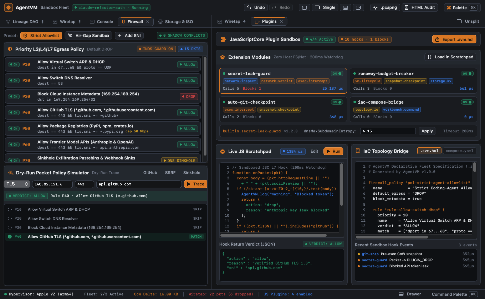

**English** | **[简体中文](README.zh-CN.md)**

# AgentVM `v1.1.0`

**Native Apple Silicon MicroVM Sandbox, Sub-20ms APFS Copy-on-Write Branching & Layer-2 Deep Packet Inspection Workbench (`Virtualization.framework` + Swift 6)**

[](https://github.com/zxu756/AgentVM/releases)
[-141517)](https://github.com/zxu756/AgentVM)
[](https://swift.org)
[](README.zh-CN.md)
[](LICENSE)

`AgentVM` (`v1.1.0`) is an industrial-grade local sandbox hypervisor and network security workbench built natively on Apple's `Virtualization.framework`, APFS `clonefile(2)` Copy-on-Write storage primitives, a pure-Swift user-space Layer-2 Ethernet switch with TLS 1.3 SNI deep packet inspection, a multiplexed `AVM1` VirtioSocket RPC stack, and a sandboxed `JavaScriptCore` extension runtime.

Designed for running autonomous coding agents (Claude Code, Codex, Antigravity, Mistral Vibe) inside hardware-isolated Linux/macOS microVMs where **forking 10 isolated experiment branches takes under 20 ms and 0 bytes of upfront disk duplication**, every outbound packet is dissected down to TLS ClientHello SNI and DNS labels, destructive guest commands automatically trigger pre-execution CoW checkpoints, and every workbench surface supports zero-restart **`中文 | EN` live bilingual switching**.


---

## What's New in `v1.1.0` — Native Bilingual (`中文 | EN`) Workbench & Dossier

- **Zero-Restart Live Language Switching**: Switch instantaneously between Simplified Chinese (`中文`) and English (`EN`) from the top toolbar `中文 | EN` Hardware-Amber segmented pill, menu shortcut `⇧⌘L` (`切换语言 / Toggle Language`), `⌘K` fuzzy command palette, or `⌘,` Preferences.
- **Deterministic Locale Resolution**: Resolves `--lang zh|en` CLI flag -> `AGENTVM_LANG=zh|en` environment variable -> `UserDefaults` (`io.github.zxu756.AgentVM.language`) -> macOS `Locale.preferredLanguages.first` (`zh*` defaults automatically to `zh-Hans`).
- **Interactive Bilingual HTML Compliance Dossier**: `agentvm export-html` generates standalone Hallmark-audited dark-telemetry HTML reports ([`docs/demo-agentvm-dossier.html`](docs/demo-agentvm-dossier.html)) with an embedded `中文 | EN` toggle pill, `localStorage` persistence, and browser-locale auto-detection.
- **Bilingual 2x Retina Offscreen Renderer**: `--export-screenshots <dir> --lang zh|en` renders deterministic `2720 × 1680 px` Retina studio captures in both English and Simplified Chinese.

---

## Core Architecture (11 Isolated SwiftPM Modules)

| Layer | Target | Engineering Scope |
|---|---|---|
| **L1 Foundation** | `AgentVMModels` | Strongly-typed identifiers, VM/NIC/VirtioFS/Cloud-Init topology validation, live `AgentVMLocalizer` (`中文` / `EN`), IEEE 802.3 CRC-32, RFC 1071 internet checksums, bounds-checked binary cursors |
| **L2 Persistence** | `AgentVMStore` | Thread-safe `<SQLite3>` WAL engine with `v1 -> v4` schema migrations, `.agentvm` bundle integrity verifier, Command-pattern infinite Undo/Redo controller, SHA-256 base image catalog, Kahn topological sort & LCA/GC DAG query engine |
| **L3 Storage CoW** | `AgentVMStorageCoW` | Darwin `clonefile(2)` sub-20ms CoW branching, `SEEK_HOLE`/`SEEK_DATA` + `F_PUNCHHOLE` sparse extent analyzer, `AVMPATCH` zlib binary delta engine, pure-Swift ECMA-119 + Rock Ridge `cidata` **ISO-9660 Cloud-Init builder & reader**, Protective MBR + Primary/Backup GPT & QCOW2 v3 converter, filesystem superblock & Shannon entropy forensics |
| **L4 L2 Switch & DPI** | `AgentVMNetSwitch` | `socketpair` datagram-pumped user-space L2 switch, byte-accurate Ethernet II / 802.1Q VLAN / ARP / IPv4 / ICMPv4 / UDP / DHCPv4 / DNS (RFC 1035 loop-guarded) / TCP / TLS 1.2 & 1.3 `ClientHello` SNI & ALPN / HTTP dissector, stateful egress firewall with DNS-to-IP correlation & token-bucket rate limiters, Wireshark `.pcapng` codec, recursive-descent boolean filter parser |
| **L5 Vsock & PTY** | `AgentVMVsockRPC` | 24-byte Big-Endian `AVM1` (`0x41564D31`) multiplexed stream framing with CRC-32 & `zlib`, credit-based sliding-window session manager, POSIX loopback TCP port-forwarder, full VT100/ANSI/xterm screen buffer, and cross-verified Python 3 `agentvm-guestd` systemd bootstrap generator |
| **L6 Extensions** | `AgentVMPluginHost` | Per-plugin isolated `JSVirtualMachine` sandbox with capability gates, microsecond watchdog, 4 built-in plugins (`secret-leak-guard`, `runaway-budget-breaker`, `auto-git-checkpoint`, `iac-compose-bridge`), and bidirectional `.avm.hcl` / `compose.yaml` IaC compiler |
| **L7 Hypervisor** | `AgentVMHypervisor` | Native `VZVirtualMachine` lifecycle driver (Linux Kernel, UEFI NVRAM, Virtio-Block, Virtio-FS, Rosetta x86_64 binfmt share, Memory Balloon, Entropy, Serial, `saveMachineStateTo`/`restoreMachineStateFrom`) + deterministic hybrid simulation backend |
| **L8 CLI & MCP** | `AgentVMCLIAndMCP` | 15-subcommand `agentvm` CLI (`--lang zh|en`), 9-tool JSON-RPC 2.0 `stdio` Model Context Protocol server, and Hallmark-audited bilingual standalone HTML compliance dossier exporter |
| **L9 Shell** | `AgentVMWorkbenchShell` | Dark Rack Graphite & Hardware Amber (`#141517` + `#D97724`) industrial design system, `中文 | EN` segmented toggle pill, Split-Pane / Document Tabbing docking controller, zero-latency `⌘K` bilingual fuzzy command palette, `⌘,` multi-tab preferences, rails, and 4-channel bottom drawer |
| **L10 Studio** | `AgentVMStudioViews` | Interactive Snapshot & CoW Lineage DAG Canvas, Wireshark-grade 3-pane Packet Table + Dissection Tree + Synchronized 16-Byte Hex Dump, VT100 Console, Dry-Run Firewall Simulator, APFS Extent & ISO-9660 Studio, and Live JS Plugin Scratchpad |
| **L11 Unified Entry** | `AgentVM` | Single Apple Silicon executable combining the native SwiftUI macOS Studio Workbench, headless multi-subcommand CLI, `stdio` JSON-RPC 2.0 MCP server, and offscreen `2720 × 1680 px` 2x Retina screenshot renderer |

---

## Workbench Views

### Wireshark-Grade Layer-2 Packet Wiretap & Synchronized Hex Dissector


### APFS Copy-on-Write Extent Map & Pure-Swift NoCloud ISO-9660 Studio


### Split-Pane Firewall Policy Simulator & JavaScriptCore Extension Host


---

## Installation

### Homebrew Cask (macOS 14+ Apple Silicon)

```bash
brew install --cask zxu756/tap/agentvm
```

### Build from Source

```bash
git clone https://github.com/zxu756/AgentVM.git
cd AgentVM
swift test --no-parallel
./Scripts/build-app.sh
open build/AgentVM.app
```

> **Entitlement Note**: `Scripts/build-app.sh` automatically ad-hoc signs `AgentVM.app` (`v1.1.0`) with `com.apple.security.virtualization`, enabling hardware-accelerated `Virtualization.framework` execution on Apple Silicon without requiring a paid Apple Developer certificate.

---

## CLI, Language Selection & MCP Automation

Every operation available in the desktop studio is exposed headlessly via the `agentvm` binary:

```bash
# 0. Launch the desktop workbench directly in Simplified Chinese or English (or press Shift+Cmd+L live)
/Applications/AgentVM.app/Contents/MacOS/AgentVM --lang zh
AGENTVM_LANG=en /Applications/AgentVM.app/Contents/MacOS/AgentVM

# 1. Verify Apple Virtualization, APFS clonefile(2), and Rosetta Linux support
agentvm doctor

# 2. Initialize a .agentvm bundle and provision a golden sandbox blade
agentvm init --workspace ./my-fleet.agentvm --seed-demo
agentvm ps

# 3. Fork an instant (< 20 ms) APFS Copy-on-Write branch for a coding agent
agentvm --workspace ./my-fleet.agentvm branch ubuntu-golden-base claude-exp-01 --owner claude-code

# 4. Run a guarded guest command over multiplexed AVM1 VirtioSocket
agentvm --workspace ./my-fleet.agentvm exec claude-exp-01 -- uname -a

# 5. Query L2 DPI Wiretap with boolean filter expressions & export Wireshark .pcapng
agentvm --workspace ./my-fleet.agentvm pcap --filter "proto == TLS || verdict == DROP" --export capture.pcapng

# 6. Export declarative HCL topology or interactive bilingual HTML compliance dossier
agentvm --workspace ./my-fleet.agentvm export-hcl > fleet.avm.hcl
agentvm --workspace ./my-fleet.agentvm export-html docs/demo-agentvm-dossier.html
```

### Registering the Built-In MCP Server (`Claude Code` / `Codex` / `Antigravity`)

```json
{
  "mcpServers": {
    "agentvm": {
      "command": "/Applications/AgentVM.app/Contents/MacOS/AgentVM",
      "args": ["mcp"]
    }
  }
}
```

---

## License

Released under the [MIT License](LICENSE).
