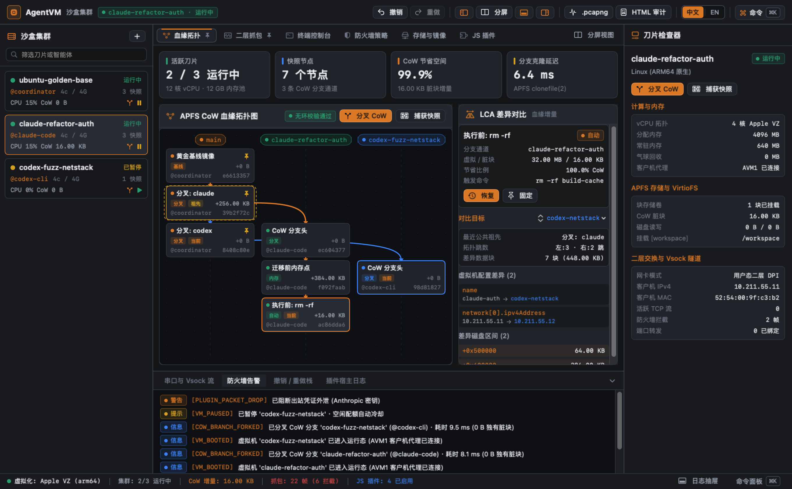

**[English](README.md)** | **简体中文**

# AgentVM `v1.1.0`

> **当前状态（M0 — 止血与诚实基线）**：APFS 写时复制（`clonefile(2)`）稀疏磁盘与快照血统管理、SQLite WAL 工作区持久化、纯 Swift NoCloud `cidata` ISO-9660 镜像生成以及 `JavaScriptCore` 策略沙盒现已在本地可用。以太网/IPv4/DNS/TLS 报文拆解和 `.pcapng` 读写目前只是库层面的能力（`AgentVMNetSwitch`，有单元测试覆盖）；命令行和桌面界面都还没有打开抓包文件的入口。真实 Linux 镜像下载、`VZVirtualMachine` 客户机启动与 `AF_VSOCK` 实时命令执行正在开发中（排在 M1–M3）。这一版还不能启动任何客户机，所以目前没有任何形式的客户机网络；用户态出站防火墙拦截与实时抓包排在 M5。

[](https://github.com/zxu756/AgentVM/releases)
[-141517)](https://github.com/zxu756/AgentVM)
[](https://swift.org)
[](README.md)
[](LICENSE)

`AgentVM` 是面向 macOS（Apple Silicon）的本地工作区管理器、APFS 写时复制磁盘与快照血统工具及协议检视工作台，基于 Swift 6 编写，桌面端与命令行（`--lang zh` / `--lang en`）均支持 `中文 | EN` 双语切换。

默认情况下，启动桌面应用或初始化 `.agentvm` 工作区均显示干净的空状态（0 台虚拟机、0 条数据包、0 条告警），绝不伪造客户机执行结果或遥测数值：

- 在当前 M0 阶段，`create` 会创建一块带 GPT 分区表的空稀疏磁盘与一张 NoCloud `cidata` ISO-9660 配置盘，磁盘内尚未安装客户机操作系统。
- 对空磁盘执行 `agentvm up <vm>` 或 `agentvm exec <vm> -- ...` 会以非零退出码返回明确错误，不会静默回退到模拟器或把状态标为 `running`。
- 主机侧协议与会话模拟仅在显式传入 `--backend simulation` 时启用，或在桌面端显式传入 `--demo` / 点击「载入演示」（带 `[演示数据]` 标记）时载入。模拟运行的每一种输出都带标记：文本逐行加 `SIMULATED:` 前缀，`ps --json` 和 MCP `agentvm_list_fleet` 的记录里有 `"simulated": true`，`export-hcl` 多一行 `# SIMULATED:` 注释，导出的 `.pcapng` 和 HTML 文件内部也写有标记。
- 模拟器留在工作区里的状态，之后谁来读都带着标记：默认的 `agentvm ps` 显示 `SIMULATED:运行中`，`ps --json` 在 `"state": "running"` 旁边是 `"simulated": true`；默认后端不会把它当真（`up`、`exec`、`pause` 会丢弃模拟状态，然后像对一台从没运行过的虚拟机那样报错）。
- 未接入真实客户机 `/proc` 数据源的 CPU 与内存指标统一显示为 `—`。
- 目前没有客户机网络，因为还不能启动客户机。虚拟机记录配置的是用户态交换机，它在 M5 之前没有通往外网的路径；`agentvm policy strict|airgap` 只是选择并保存一个预设，对真实流量不做任何拦截。界面上的抓包与防火墙面板均明确显示「尚未接入真实流量（排在 M5）」。
- `agentvm doctor` 会如实报告当前可执行文件有没有 `com.apple.security.virtualization` 权限。直接用 `swift build` 编出来的二进制没有这项权限，`doctor` 会明说，不写「通过」。

---

## 当前状态与里程碑路线图

| 里程碑 | 能力范围 | 状态 |
|---|---|---|
| **M0** | 诚实基线止血：修复普通模式 `agentvm ps` 崩溃、`doctor` 实测执行 `clonefile(2)` 探测并真实读取虚拟化权限、界面默认空状态、显式 `--backend simulation`（每一种输出和落盘的状态都带 `SIMULATED` 标记）、`[演示数据]` 隔离、未实测遥测显示 `—`、`JavaScriptCore` 插件抢占式超时看门狗 | **已完成** |
| **M1** | `agentvm image pull debian-12-bookworm-arm64` 与单命令 `agentvm run`：基于 `VZVirtualMachine` 启动真实 Debian 12 Linux 客户机，通过真实 `AF_VSOCK` 回传标准输出/标准错误/退出码并采集 `/proc` 遥测 | 规划中 |
| **M2** | 每台虚拟机独立后台常驻守护进程，使 `up`、`exec`、`pause`、`resume`、`halt` 可跨独立命令行进程协同工作 | 规划中 |
| **M3** | 基于真实装有操作系统的虚拟机验证 APFS CoW 分叉（`branch`）与快照恢复（`snapshot` / `restore`），并在完成后公布实测耗时与增量字节数 | 规划中 |
| **M4** | 桌面界面完整对接真实运行中的虚拟机、串口输出与工作区状态 | 规划中 |
| **M5** | 真实客户机网卡接入用户态二层交换机、DNS/TLS SNI 出站访问控制与真实流量 `.pcapng` 导出 | 规划中（待 M4 后评估） |

---

## 已验证命令行示例

从源码编译 `AgentVM` 后，可在独立 `.agentvm` 工作区中直接复现以下命令。以 `# ->` 开头的行是文档记录的结果，`...` 代表每次不同的内容（ID、路径、耗时）。`Scripts/acceptance/readme-commands.sh` 直接读取这个代码块，命令或这些结果对不上时会失败。

```bash
swift build --product AgentVM
alias agentvm="$(pwd)/.build/debug/AgentVM"

# 1. 宿主机就绪自检（在工作区所在卷上执行一次真实的 APFS clonefile(2) 临时克隆探测；读取当前可执行文件的虚拟化权限）
agentvm --lang zh --workspace ./demo-check.agentvm doctor
# -> APFS clonefile(2) : 通过 (实测 clonefile(2) 写时复制克隆成功)

# 2. 初始化空工作区并创建一台空稀疏 GPT 磁盘虚拟机记录
agentvm --lang zh --workspace ./demo-check.agentvm init
# -> 已初始化空工作区「demo-check」（...）：...
agentvm --lang zh --workspace ./demo-check.agentvm create sandbox-a
# -> 已创建虚拟机「sandbox-a」（...），根快照 ...（空稀疏 GPT 磁盘，未安装客户机系统）

# 3. 查看虚拟机表格或 JSON 输出（未实测的 CPU/内存统一显示为 —）
agentvm --lang zh --workspace ./demo-check.agentvm ps
# -> sandbox-a ... 已停止
agentvm --lang zh --workspace ./demo-check.agentvm ps --json
# -> "state" : "stopped"

# 4. 派生 APFS 写时复制磁盘分支、列出快照、查看插件并导出 HCL 清单
agentvm --lang zh --workspace ./demo-check.agentvm branch sandbox-a sandbox-b --no-boot
# -> 已通过 clonefile(2) 派生 CoW 分支「sandbox-b」（...），耗时 ... ms，父快照 ...
agentvm --lang zh --workspace ./demo-check.agentvm snapshot list
# -> Golden Base (sandbox-a) ... Branch Fork -> sandbox-b ... CoW Head (sandbox-b)
agentvm --lang zh --workspace ./demo-check.agentvm plugin
# -> builtin.secret-leak-guard ... 已启用
agentvm --lang zh --workspace ./demo-check.agentvm export-hcl
# -> sandbox_vm "sandbox-a" ... sandbox_vm "sandbox-b"

# 5. 对无操作系统的空磁盘执行 up 或 exec 会诚实返回非零退出码与错误说明
agentvm --lang zh --workspace ./demo-check.agentvm up sandbox-a
# -> 非零退出码：[ERR_NO_BOOTABLE_SYSTEM] 虚拟机「sandbox-a」磁盘上没有可引导的客户机系统（内核或根文件系统缺失）...
agentvm --lang zh --workspace ./demo-check.agentvm exec sandbox-a -- uname -a
# -> 非零退出码：[ERR_NO_BOOTABLE_SYSTEM] 虚拟机「sandbox-a」磁盘上没有可引导的客户机系统（内核或根文件系统缺失）...

# 6. 仅当显式指定 --backend simulation 时才运行主机侧模拟，且输出强制带 SIMULATED: 前缀
#    （不管虚拟机叫什么，模拟器回的主机名都是固定的 "agent-sandbox"）
agentvm --lang zh --workspace ./demo-check.agentvm --backend simulation exec sandbox-a -- uname -a
# -> SIMULATED: Linux agent-sandbox 6.8.0-agentvm-arm64 #1 SMP PREEMPT_DYNAMIC aarch64 GNU/Linux

# 7. 模拟器留下的状态，默认后端读到时仍然带标记，文本和 JSON 都是
agentvm --lang zh --workspace ./demo-check.agentvm ps
# -> sandbox-a ... SIMULATED:运行中
# -> SIMULATED: 上面有 1 台虚拟机的状态是 --backend simulation 写入的模拟状态，没有真实的客户机在运行。
agentvm --lang zh --workspace ./demo-check.agentvm ps --json
# -> "simulated" : true
agentvm --lang zh --workspace ./demo-check.agentvm --backend simulation halt sandbox-a
# -> SIMULATED: 虚拟机「sandbox-a」（...）-> 已停止
```

不认识的选项会报错，不会被忽略：`agentvm ps --bogus` 的退出码是 2。

所有命令同样支持 `--lang en`（或环境变量 `AGENTVM_LANG=en`）输出英文：

```bash
agentvm --lang en --workspace ./demo-check.agentvm doctor
agentvm --lang en --workspace ./demo-check.agentvm ps
```

---

## 桌面工作台界面预览（`[演示数据]` 合成样本）

> **演示数据说明**：下方截图均通过显式 `--demo` 模式渲染（顶部带有 `演示数据 · 合成样本` 标识）。图中的虚拟机、CoW 分支、以太网/TLS 数据帧与策略计数均为离线合成演示样本，并非采集自真实运行中的客户机。正常启动 `AgentVM` 默认显示空工作区。这些图是在状态栏修正之前渲染的：图里状态栏写着 `虚拟化: Apple VZ`，而演示集群实际运行在主机侧模拟器上。当前版本在演示模式下状态栏显示 `虚拟化: SIMULATED 模拟`，每台演示虚拟机的状态显示为 `SIMULATED 模拟 · 运行中`；截图还没有重新渲染。

### 总览与快照血统拓扑图（`[演示数据]` 合成样本）


### 离线协议拆解与十六进制视图（`[演示数据]` 合成样本 — 真实流量排在 M5）


### APFS 稀疏区段图谱与 NoCloud ISO-9660 检视器（`[演示数据]` 合成样本）


### 防火墙规则干跑模拟与 JavaScriptCore 扩展宿主（`[演示数据]` 合成样本 — 真实流量排在 M5）


---

## 测试与验收脚本

```bash
# 按模块运行范围单元测试
./Scripts/test.sh scope AgentVMStore AgentVMHypervisor AgentVMCLIAndMCP

# 在临时工作区中逐条回放 README 中的全部命令
./Scripts/acceptance/readme-commands.sh

# 运行完整 M0 验收套件（20 次冷启动稳定性、诚实报错检查、命令行和 MCP 的模拟标记检查、
# doctor 权限检查、策略持久化、仓库零残留、界面默认空状态检查）。
# 任何脚本都不启动桌面界面：界面那一行是不带窗口的 ViewModel 测试。
./Scripts/test.sh milestone 0
```

---

## 构建 macOS 应用包

```bash
./Scripts/build-app.sh
# 正常启动（默认空状态：0 台虚拟机、0 条数据包、0 条告警）：
open build/AgentVM.app
# 或显式启用合成演示模式启动：
./build/AgentVM.app/Contents/MacOS/AgentVM --demo
```

`Scripts/build-app.sh` 会在 Apple Silicon（`macOS 14+`）上使用 `com.apple.security.virtualization` 权限对 `AgentVM.app` 执行本地 Ad-Hoc 签名。`swift build` 产出的 `.build/debug/AgentVM` 没有用这项权限签名，`agentvm doctor` 会如实报告。

---

## 开源许可

本项目基于 [MIT License](LICENSE) 开源发布。
