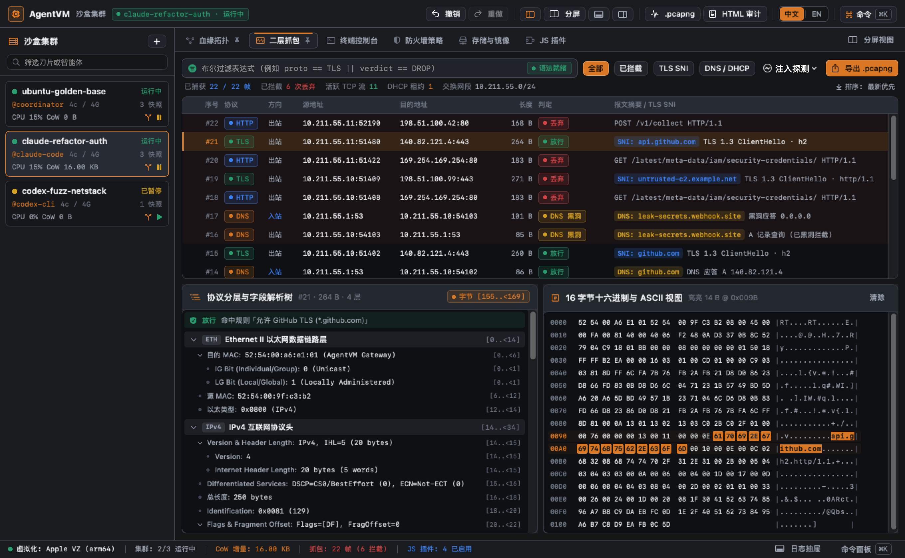
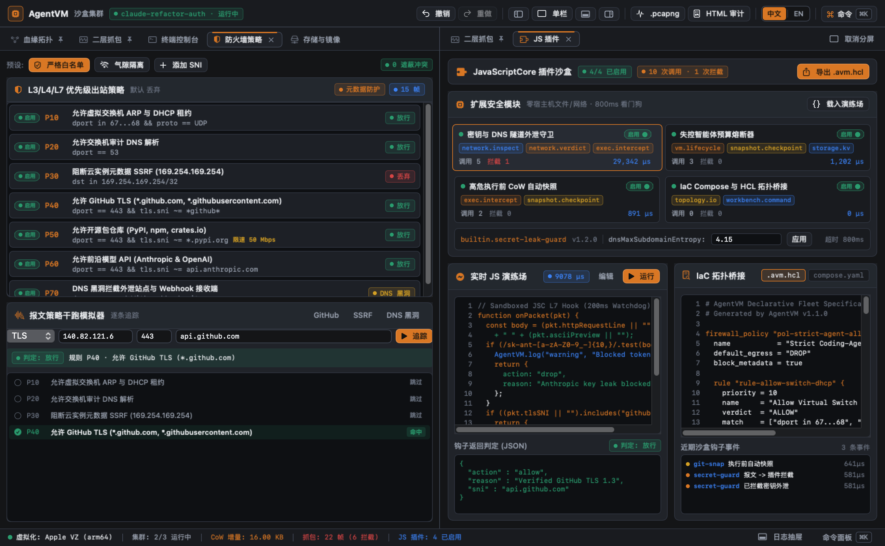

**[English](README.md)** | **简体中文**

# AgentVM `v1.4.0`

> 在 Mac 上给 coding agent 开真实的 Linux 虚拟机：`agentvm exec` 与 MCP `agentvm_exec_command` 的输出来自客户机本身，VirtioFS 把宿主机项目目录共享进 `/workspace`，本地 TCP 端口经 `AF_VSOCK` 转发进客户机；分叉一台带数据的虚拟机用时 **32.49 毫秒**（停机分叉墙钟中位数；最近秩 95 分位 **58.26 毫秒**）、多占 **0 字节**（APFS 克隆私有字节）。
>
> *分叉基准实测于 `2026-11-21`，由 `Scripts/acceptance/m3-branch-bench.sh`（结果文件 `reports/m3-branch-bench.json`，可通过 `AGENTVM_REAL_VM=1 ./Scripts/test.sh milestone 3 --record` 复现）在 `Mac16,10`（`Apple M4`，10 核，16 GiB 内存）、macOS `27.0.1`（`26A434`）、APFS 卷上测得，宿主机 `uptime` 1m/5m/15m 负载开始为 `1.77 2.24 2.39`、结束为 `1.98 2.53 2.51`；父机为扩容至 `8 GiB` 的 `debian-12-bookworm-arm64` 磁盘，客户机内写入 `1 GiB` 随机数据（`/var/tmp/bench-data.bin`）并 `sync`：16 次停机 `agentvm branch` 进程墙钟中位数为 `32.49 ms`（最小 `26.48 ms`，95 分位 `58.26 ms`；命令行内部从拿锁到写入 SQLite 中位数 `13.52 ms`）；16 次经工作区守护进程执行的运行中 `agentvm branch` 进程墙钟中位数为 `115.31 ms`（最小 `102.90 ms`，95 分位 `164.82 ms`），父机暂停时长（`VM_PAUSED_FOR_SNAPSHOT`）中位数为 `0.603 ms`（95 分位 `0.796 ms`；暂停前客户机 `sync` 中位数 `1.004 ms`）。每次分叉新建的克隆文件（`.raw` / `.nvram`）由独立脚本经 Darwin `getattrlist(ATTR_CMNEXT_PRIVATESIZE)` 读取的不与其他克隆共享的私有字节均为 `0 B`（不含 APFS 文件系统元数据及新生成的 `114688 B` `cidata` ISO 与 `70 B` `.machineid` 文件；16 次停机 / 16 次运行中分叉前后的整卷 `df -k` 可用空间差值为 `7256 KB` / `7936 KB`，宿主机有并发任务时仅作上限参考）。32 台子机依次开机核对客户机身份（与父机共 33 台机器的五项持久身份全部两两不同、并发 IPv4 零冲突）并关机后，子机根盘 APFS 私有字节中位数为 `6131712 B`（`5.85 MiB`，95 分位 `6922240 B` / `6.60 MiB`）。*
>
> *M4 编码智能体验收实测于 `2026-11-22`（`4:05`–`4:06`，提交 `209f2f6`），由 `AGENTVM_REAL_VM=1 ./Scripts/acceptance/m4-agent.sh --record`（结果文件 `reports/m4-agent.txt`、`reports/m4-agent.json`，报告见 `reports/AgentVM-M4.md`）在 `Mac16,10`（`Apple M4`，10 核，`16.0 GiB` 内存，macOS `27.0.1` `26A434`，`arm64`，APFS；宿主机 `uptime` 负载开始 `5.44 4.43 3.97`、结束 `5.42 4.79 4.16`）上对真实 `debian-12-bookworm-arm64`（内核 `6.1.0-54-cloud-arm64`）客户机测得，第 1–14 行 `14/14` 全部通过（`0` 失败、`0` 未跑），总耗时 `72.53 s`：`64 MiB` VirtioFS 写入吞吐 `898.1 MiB/s`（为单次 `64 MiB` 含 `fsync` 写入的测量，随宿主机磁盘负载波动很大：此前提交 `f6b264a` 的旧记录实测写 `15.4 MiB/s`、读 `1659.2 MiB/s`，本次提交 `209f2f6` 的新记录实测写 `898.1 MiB/s`，两份均为真实测得）、客户机读取吞吐 `1731.5 MiB/s`，宿主机与客户机双向 SHA-256 完全一致；经 `AF_VSOCK` 的本地 TCP 端口转发 `50` 次 HTTP GET 延迟中位数 `0.683 ms`（最小 `0.599 ms`，95 分位 `0.864 ms`），`64 MiB` 下载吞吐 `79.53 MiB/s` 且期间并发执行的 `5/5` 次 `agentvm exec` 全部通过（另一次独立核对录得 50 次短请求延迟中位数 `0.485 ms` / 95 分位 `0.559 ms`、`64 MiB` 下载约 `295 MiB/s`）；仓库外真实 Python 标准库项目（`code-review/evals`）在宿主机与客户机各跑 `60/60` 个 `unittest` 测试，退出码与通过数完全一致。各行具体耗时（`t1` 冷启动、MCP 运行中写时复制分叉与快照回滚、`agent-relay verify` 及客户机 `reboot` 自动恢复等）见 `reports/m4-agent.txt`。*

> **当前状态（M4 — 编码智能体 MCP 接入守护进程、VirtioFS 目录共享、本地端口转发与 `agent-relay` 接入）**：`agentvm mcp` 现已通过 Unix 域套接字连接工作区后台守护进程，使 coding agent 可经 stdio JSON-RPC 2.0 对真实 `VZVirtualMachine` 客户机完成建机开机、列表查询、分叉、快照、回滚与命令执行；`create --mount <宿主机目录>:<客户机绝对路径>[:ro]` 通过 VirtioFS 与 NoCloud `cloud-init` 把宿主机目录共享进客户机（`branch --no-mounts` 可不继承父机共享）；`forward <vm> <宿主机端口>:<客户机端口> [--foreground]`、`forward list` 与 `forward stop` 在守护进程内将本地端口经 `AF_VSOCK` 多路复用转发至客户机，支持写半关闭（`SHUT_WR`）传递与客户机重启自动恢复；`agent-relay`（`relay.sh verify`）可直接包住 `agentvm exec` 在真虚拟机内跑项目测试并写入 `.relay/LOG.md` 验收记录。启动虚拟机需要带 `com.apple.security.virtualization` 权限签名的二进制，直接 `swift build` 编出来的没有。桌面界面接入守护进程、虚拟机/快照删除命令（`rm`）以及交互终端 / `exec` 标准输入透传尚未实现；客户机网络走系统 NAT，用户态交换机出站管控与实时抓包排在 M5（默认后端下 `agentvm_query_wiretap` 与 `agentvm_set_firewall_preset` 返回 `isError: true` `[ERR_UNIMPLEMENTED_BEFORE_M5]`）。

[](https://github.com/zxu756/AgentVM/releases)
[-141517)](https://github.com/zxu756/AgentVM)
[](https://swift.org)
[](README.md)
[](LICENSE)

`AgentVM` 是面向 macOS（Apple Silicon）的本地工作区管理器和 APFS 写时复制磁盘与快照血统工具，带命令行、stdio MCP 服务和桌面工作台，基于 Swift 6 编写，桌面端与命令行（`--lang zh` / `--lang en`）均支持 `中文 | EN` 双语切换。常驻真实虚拟机由每个工作区一个后台守护进程持有（`agentvm up` / `exec` / `forward` / `pause` / `resume` / `halt` / `branch` / `snapshot` / `restore` 与 `agentvm mcp`），一次性执行仍可走 `agentvm run`；工作台里的抓包与防火墙视图在 M5 之前没有真实流量可看。

默认情况下，启动桌面应用或初始化 `.agentvm` 工作区均显示干净的空状态（0 台虚拟机、0 条数据包、0 条告警），绝不伪造客户机执行结果或遥测数值：

- **VirtioFS 目录共享（`create --mount` 与 `branch --no-mounts`）**：`agentvm create <名称> ... --mount <宿主机目录>:<客户机绝对路径>[:ro]` 可重复指定多个共享目录，底层配置 `VZVirtioFileSystemDeviceConfiguration`（`VZSharedDirectory(url:readOnly:)`），并在 `cloud-init` `user-data` 中生成创建挂载点的 `bootcmd` 与 `virtiofs` `mounts:` 条目（`rw,nofail,x-systemd.before=local-fs.target` 或 `ro,nofail,x-systemd.before=local-fs.target`）。`create` 与 `up` 开机前都会显式校验宿主机路径存在且为目录，缺失或非目录时立即以退出码 `1` 返回 `[ERR_SHARED_DIR_INVALID]`，绝不静默跳过。客户机内无论以 `root` 还是普通用户 `agent` 在读写共享目录中新建文件，宿主机侧属主均为当前宿主用户（`stat -f '%u' == id -u`）；只读共享（`:ro`）会拦截写入、删除与 `rw` 重挂载。`branch` 默认继承父机的 `virtioFSMounts` 与 `cloud-init` `mounts:`，传入 `branch <父机> <子机> --no-mounts` 则剥离共享挂载配置。
- **守护进程托管的本地端口转发（`forward`）**：`agentvm forward <vm> <宿主机端口>:<客户机端口>` 由工作区守护进程在 `127.0.0.1:<宿主机端口>` 监听并持久化到虚拟机配置，经现有 `AF_VSOCK` 多路复用通道（`CHAN_TCP_PORT_FORWARD`）转发至客户机 `127.0.0.1:<guest-port>`（`agentvm-guestd.py` v2）。客户端写半关闭（`shutdown(SHUT_WR)`）会以 `FLAG_FIN` 传递而不会提前截断回包流，慢响应可完整收回；宿主机端口冲突或权限不足立即返回退出码 `1`（`[ERR_PORT_FORWARD_BIND]`，附中英文原因与 `errno`）。转发规则在客户机 `reboot` 后自动恢复、`halt` 后自动释放，可通过 `agentvm forward list [--vm <vm>] [--json]` 查询、`agentvm forward stop <vm> <宿主机端口>` 停止，亦支持 `--foreground`（前台阻塞直至收到 `SIGINT` / `SIGTERM` 时自动解绑并以退出码 `0` 退出）。
- **接入工作区守护进程的 stdio MCP 服务（`agentvm mcp`）**：保持原有 9 个工具名不变（`agentvm_list_fleet`、`agentvm_create_vm`、`agentvm_fork_cow_branch`、`agentvm_exec_command`、`agentvm_capture_snapshot`、`agentvm_restore_snapshot`、`agentvm_query_wiretap`、`agentvm_set_firewall_preset`、`agentvm_doctor`），所有运行态查询、命令执行与开机均经守护进程 RPC 完成，MCP 进程自身不直接创建 `VZVirtualMachine`：
  - `agentvm_create_vm` 新增可选参数 `image`（字符串）、`diskSize`（字符串，需配合 `image`）、`mounts`（`[{hostPath, guestPath, readOnly?}]`）与 `bootImmediately`（布尔值，建机后按需拉起/连接工作区守护进程开机）。
  - `agentvm_fork_cow_branch` 的 `parentVMID` 支持传虚拟机名称或 `vm-...` ID，新增可选 `inheritMounts`（默认 `true`）并在 `bootImmediately: true` 时经工作区守护进程启动子机。
  - `agentvm_exec_command` 的 `vmID` 支持传名称或 ID，支持可选 `workingDirectory`（默认 `"/"`）、`runAsUser`（默认 `"root"`）、`timeoutSeconds`（默认 `3600`）与 `environment`（字符串字典），经守护进程流式收集输出（客户端侧默认上限 `16 MiB`，超限报 `[ERR_EXEC_OUTPUT_OVERFLOW]`）；客户机命令非零退出时返回 `isError: false` 并带 `exitCode=<N>`，对停机虚拟机调用返回 `isError: true`（`[ERR_LIFECYCLE_STATE]`）。
  - `agentvm_list_fleet` 优先向守护进程查询实时运行态，守护进程未运行时回退读取经锁对账的 SQLite 记录；`agentvm_capture_snapshot` 与 `agentvm_restore_snapshot` 在机器由守护进程持有时经守护进程执行。
  - `agentvm_query_wiretap` 与 `agentvm_set_firewall_preset` 在默认硬件后端下统一返回 `isError: true`（`[ERR_UNIMPLEMENTED_BEFORE_M5]`）且不改动工作区策略；仅在显式 `--backend simulation` 下保留带 `SIMULATED:` 前缀的演示输出。
- **APFS 写时复制磁盘分叉、子机独立身份与运行中快照回滚**：`create` 创建空稀疏 GPT 盘与 NoCloud `cidata` ISO（传 `--image debian-12-bookworm-arm64` 时走 `clonefile(2)`，`ps` 与 `snapshot list` 通过 `getattrlist(ATTR_CMNEXT_PRIVATESIZE)` 统计私有字节）。`branch` 为每台子机生成独立 `cidata` ISO（独立 `instance-id`、RFC 1123 主机名、`dhcp-identifier: mac`、`cloud-init-per instance avm-machine-id`）及新 MAC 与 `VZGenericMachineIdentifier`。运行中 `branch`、`snapshot` 以及命中内置破坏性命令守卫（如 `rm -rf`、`apt-get install`、`mkfs`、`dd of=/dev/...`）前的 `auto-pre-cmd` 自动检查点均经 `AF_VSOCK` 先调客户机 `/bin/sync`，再短暂 `pause` 执行 `clonefile(2)` 后 `resume`（因 `Virtualization.framework` 恢复内存状态不允许更换 MAC 与机器标识，不做内存态分叉）。任何 `restore` 均先留存一份 `auto: before restore <快照ID>` 快照。
- **显式模拟隔离与诚实遥测**：主机侧模拟仅在显式传入 `--backend simulation` 或桌面端 `--demo`（带 `[演示数据]` 标记）时启用，所有输出均带 `SIMULATED` 标记；未实测或过期的 CPU/内存指标显示为 `—`；`agentvm doctor` 实测 `clonefile(2)` 并如实检查当前可执行文件是否带 `com.apple.security.virtualization` 权限。

---

## 当前边界与后续计划

- **桌面界面尚未接入工作区守护进程**：桌面工作台目前只读磁盘上的工作区数据，不能直接操控守护进程持有的运行中虚拟机；界面上的抓包与防火墙面板也明确显示「尚未接入真实流量（排在 M5）」。
- **尚未提供 `rm` 删除命令与交互终端**：当前没有虚拟机删除（`rm`）或快照删除（`snapshot rm`）命令，也没有交互式 TTY 终端与 `exec` 标准输入流透传（`exec` 标准输入固定为 `/dev/null`）；反复分叉或触发检查点会在工作区内累积快照文件（初始私有字节为 `0 B`，随写入差异增长），通过 MCP 启动的虚拟机需用命令行 `agentvm halt` 或 `agentvm daemon stop` 关停。
- **两个 M5 网络工具尚未实现**：默认硬件后端下 MCP 的 `agentvm_query_wiretap` 与 `agentvm_set_firewall_preset` 均返回 `isError: true`（`[ERR_UNIMPLEMENTED_BEFORE_M5]`）。M5 之前真实客户机网络走 macOS 系统 NAT，未接入用户态二层交换机、无域名出站过滤或真实流量 `.pcapng` 抓包（`agentvm policy strict|airgap` 仅保存预设；选了 `airgap` 时 `up` 退出码为 `1`、`run` 退出码为 `125`）。
- **多台分叉子机共享同一个读写目录会互相改写**：`branch` 默认继承父机的 `--mount` 共享目录；若多台分叉子机同时运行并共享同一个宿主机读写目录，它们会直接读写并互相覆盖同一份宿主机文件。并发跑多分支实验时请加 `branch <父机> <子机> --no-mounts`，或分别为各台虚拟机挂载独立的宿主机临时/克隆目录。
- **单工作区用户态守护进程边界**：每个工作区的后台守护进程（`<工作区>/run/daemon.sock`）由命令按需经双 fork + `setsid` 启动（不写 `launchd`），注销 macOS 会话或重启宿主机不保留运行中的虚拟机。
- **已修复（A63）：`image pull` 或刚写出的镜像紧接着首次开机偶发根文件系统只读或开不了机**：此前在 `image pull` 或刚写出基础镜像后立即首次启动虚拟机，偶发客户机根文件系统只读或开不了机。现已将可写磁盘的缓存模式改为 `cached`、同步模式仍是 `fsync`（修复前建的机器下次 `up` 自动生效），并在拉取镜像时执行 `F_FULLFSYNC` 落盘（提交 `b27e442`、`209f2f6`）；快速复现修复前 6 轮失败 3 轮、修复后 10 轮 0 失败，本机回环 `image pull` 修复后 10 轮 0 失败。代价是客户机写入先进宿主机页缓存、客户机刷盘时落盘，宿主机突然断电时没刷盘的写入可能丢失。

---

## 当前状态与里程碑路线图

| 里程碑 | 能力范围 | 状态 |
|---|---|---|
| **M0** | 诚实基线止血：修复普通模式 `agentvm ps` 崩溃、`doctor` 实测执行 `clonefile(2)` 探测并真实读取虚拟化权限、界面默认空状态、显式 `--backend simulation`（每一种输出和落盘的状态都带 `SIMULATED` 标记）、`[演示数据]` 隔离、未实测遥测显示 `—`、`JavaScriptCore` 插件抢占式超时看门狗 | **已完成** |
| **M1** | `agentvm image pull debian-12-bookworm-arm64` 与单命令 `agentvm run`：基于 `VZVirtualMachine` 启动真实 Debian 12 Linux 客户机，通过真实 `AF_VSOCK` 回传标准输出/标准错误/退出码 | **已完成** |
| **M2** | 每个工作区一个后台常驻守护进程，使 `up`、`exec`、`pause`、`resume`、`halt`、`daemon`、`events` 可跨独立命令行进程协同工作，并接入客户机 `/proc` 实时 CPU、内存与运行时长遥测 | **已完成** |
| **M3** | 停机与运行中 APFS CoW 分叉（`branch` / `branch --boot`）、子机独立 `cidata` 身份重建、运行中 `sync`+`pause` 快照（`snapshot`）、自动留存回滚前快照与运行中回滚（`restore`）、破坏性命令前自动检查点及 APFS 私有字节统计（停机分叉中位数 `32.49 ms`、运行中分叉中位数 `115.31 ms`、新建克隆私有字节 `0 B`） | **已完成** |
| **M4** | 给 coding agent 用：`agentvm mcp` 接入工作区守护进程（扩展 `create_vm`、`fork_cow_branch`、`exec_command` 并对两个 M5 工具在默认后端返回 `ERR_UNIMPLEMENTED_BEFORE_M5`）、VirtioFS 目录共享（`create --mount`、`branch --no-mounts`）、守护进程托管本地端口转发（`forward`、`list`、`stop`、`--foreground` 及 `SHUT_WR` 半关闭传递）与 `agent-relay verify` 接入 | **已完成** |
| **M5** | 真实客户机网卡接入用户态二层交换机、DNS/TLS SNI 出站访问控制与真实流量 `.pcapng` 导出 | 规划中（待 M4 后评估） |

---

## 已验证命令行示例

从源码编译 `AgentVM` 后，可在独立 `.agentvm` 工作区中直接复现以下命令。以 `# ->` 开头的行是文档记录的结果，`...` 代表每次不同的内容（ID、路径、耗时）。`Scripts/acceptance/readme-commands.sh` 直接读取这个代码块，命令或这些结果对不上时会失败。

```bash
swift build --product AgentVM
alias agentvm="$(pwd)/.build/debug/AgentVM"

# 1. 宿主机就绪自检（在工作区所在卷上执行一次真实的 APFS clonefile(2) 临时克隆探测；读取当前可执行文件的虚拟化权限）
agentvm --lang zh --workspace ./demo-check.agentvm doctor
# -> APFS clonefile(2) : 通过 (实测 clonefile(2) 写时复制克隆成功)

# 2. 初始化空工作区并创建空稀疏 GPT 磁盘虚拟机记录（含可重复指定的 --mount 共享目录）
agentvm --lang zh --workspace ./demo-check.agentvm init
# -> 已初始化空工作区「demo-check」（...）：...
agentvm --lang zh --workspace ./demo-check.agentvm create sandbox-a
# -> 已创建虚拟机「sandbox-a」（...），根快照 ...（空稀疏 GPT 磁盘，未安装客户机系统）
agentvm --lang zh --workspace ./demo-check.agentvm create mount-a --mount .:/workspace --mount .:/mnt/ro:ro
# -> 已创建虚拟机「mount-a」（...），根快照 ...（空稀疏 GPT 磁盘，未安装客户机系统）

# 3. 查看虚拟机表格或 JSON 输出（未实测的 CPU/内存统一显示为 —；JSON 记录 virtioFSMounts）
agentvm --lang zh --workspace ./demo-check.agentvm ps
# -> sandbox-a ... 已停止
agentvm --lang zh --workspace ./demo-check.agentvm ps --json
# -> "guestMountPoint" : "\/workspace"

# 4. 派生 APFS 写时复制分支（默认继承挂载，或用 --no-mounts 剥离共享目录）、捕获快照、查看插件并导出 HCL 清单
agentvm --lang zh --workspace ./demo-check.agentvm branch sandbox-a sandbox-b --no-boot
# -> 已通过 clonefile(2) 派生 CoW 分支「sandbox-b」（...），耗时 ... ms，父快照 ...
agentvm --lang zh --workspace ./demo-check.agentvm branch mount-a mount-b --no-mounts
# -> 已通过 clonefile(2) 派生 CoW 分支「mount-b」（...），耗时 ... ms，父快照 ...
agentvm --lang zh --workspace ./demo-check.agentvm snapshot sandbox-a before-experiment
# -> 已为 vm-... 捕获快照 snap-...（「before-experiment」）
agentvm --lang zh --workspace ./demo-check.agentvm snapshot list
# -> Golden Base (sandbox-a) ... Branch Fork -> sandbox-b ... CoW Head (sandbox-b) ... before-experiment
agentvm --lang zh --workspace ./demo-check.agentvm plugin
# -> builtin.secret-leak-guard ... 已启用
agentvm --lang zh --workspace ./demo-check.agentvm export-hcl
# -> sandbox_vm "sandbox-a" ... sandbox_vm "sandbox-b"

# 5. 查看端口转发规则，并验证对无操作系统或已停止虚拟机操作时无需拉起守护进程即可诚实报错
agentvm --lang zh --workspace ./demo-check.agentvm forward list
# -> 当前没有活动的端口转发。
agentvm --lang zh --workspace ./demo-check.agentvm forward list --json
# -> [
agentvm --lang zh --workspace ./demo-check.agentvm forward sandbox-a 18080:8000
# -> 非零退出码：[ERR_LIFECYCLE_STATE] 无法为虚拟机「sandbox-a」（...）设置端口转发：当前状态为「stopped」，需要先启动虚拟机。
agentvm --lang zh --workspace ./demo-check.agentvm up sandbox-a
# -> 非零退出码：[ERR_NO_BOOTABLE_SYSTEM] 虚拟机「sandbox-a」磁盘上没有可引导的客户机系统（内核或根文件系统缺失）...
agentvm --lang zh --workspace ./demo-check.agentvm branch sandbox-a sandbox-c --boot
# -> 非零退出码：[ERR_NO_BOOTABLE_SYSTEM] 虚拟机「sandbox-a」磁盘上没有可引导的客户机系统（内核或根文件系统缺失）...
agentvm --lang zh --workspace ./demo-check.agentvm exec sandbox-a -- uname -a
# -> 非零退出码：[ERR_LIFECYCLE_STATE] 虚拟机「sandbox-a」（...）当前处于「stopped」状态（客户机未在运行），无法在客户机中执行命令。请先运行 'agentvm up sandbox-a' 启动虚拟机。
agentvm --lang zh --workspace ./demo-check.agentvm halt sandbox-a
# -> 虚拟机「sandbox-a」（...）-> 已停止
agentvm --lang zh --workspace ./demo-check.agentvm daemon status
# -> 非零退出码：守护进程未运行（工作区：...）。
agentvm --lang zh --workspace ./demo-check.agentvm daemon stop
# -> 守护进程未运行，无需停止。
agentvm --lang zh --workspace ./demo-check.agentvm events --json
# -> "code" : "COW_BRANCH_FORKED"

# 6. 仅当显式指定 --backend simulation 时才运行主机侧模拟，且输出强制带 SIMULATED: 前缀
#    （不管虚拟机叫什么，模拟器回的主机名都是固定的 "agent-sandbox"）
agentvm --lang zh --workspace ./demo-check.agentvm --backend simulation exec sandbox-a -- uname -a
# -> SIMULATED: Linux agent-sandbox 6.8.0-agentvm-arm64 #1 SMP PREEMPT_DYNAMIC aarch64 GNU/Linux

# 7. 模拟器留下的状态，默认后端读到时仍然带标记，文本和 JSON 都是
agentvm --lang zh --workspace ./demo-check.agentvm ps
# -> sandbox-a ... SIMULATED:运行中
# -> SIMULATED: 上面有 1 台虚拟机的状态是 --backend simulation 写入的模拟状态，没有真实的客户机在运行。
agentvm --lang zh --workspace ./demo-check.agentvm ps --json
# -> "simulated" : true
agentvm --lang zh --workspace ./demo-check.agentvm --backend simulation halt sandbox-a
# -> SIMULATED: 虚拟机「sandbox-a」（...）-> 已停止
```

不认识的选项会报错，不会被忽略：`agentvm ps --bogus` 的退出码是 2。所有命令同样支持 `--lang en`（或环境变量 `AGENTVM_LANG=en`）输出英文：

```bash
agentvm --lang en --workspace ./demo-check.agentvm doctor
agentvm --lang en --workspace ./demo-check.agentvm ps
```

---

## 接入 `agent-relay` 在真虚拟机内执行验收

使用带虚拟化权限签名的 `agentvm` 二进制与已缓存的 `debian-12-bookworm-arm64` 镜像（`agentvm image pull debian-12-bookworm-arm64`）时，`agent-relay` 的 `relay.sh verify` 子命令可直接包住 `agentvm exec`（以 `argv` 数组直接执行 `--` 后的命令，不调用外部 agent CLI，原样透传客户机退出码，转发 `SIGTERM` 取消信号，并在 `$PROJECT_DIR/.relay/LOG.md` 追加结构化通过/失败记录；由 `Scripts/acceptance/m4-agent.sh` 第 12 行端到端验证）：

```bash
# 1. 创建将宿主机 $PROJECT_DIR 挂载到 /workspace 的虚拟机并经工作区守护进程启动
agentvm --workspace ./relay-demo.agentvm create t1 --image debian-12-bookworm-arm64 --mount "$PROJECT_DIR:/workspace"
agentvm --workspace ./relay-demo.agentvm up t1

# 2. 用 agent-relay 的 verify 子命令在真虚拟机沙箱里跑项目测试并留存 .relay/LOG.md 证据
~/.agents/skills/agent-relay/scripts/relay.sh verify "$PROJECT_DIR" "run-tests-in-vm" -- agentvm --workspace ./relay-demo.agentvm exec t1 -- python3 -B -m unittest discover -s /workspace -v

# 3. 用完停机
agentvm --workspace ./relay-demo.agentvm halt t1
```

若测试命令需要 `cd /workspace && ...` 等 shell 语法，可在 `exec t1` 后写成 `-- /bin/sh -c 'cd /workspace && python3 -B -m unittest discover -v'`。

---

## 桌面工作台界面预览（`[演示数据]` 合成样本）

> **演示数据说明**：下方截图均通过显式 `--demo` 模式渲染（顶部带有 `演示数据 · 合成样本` 标识）。图中的虚拟机、CoW 分支、以太网/TLS 数据帧与策略计数均为离线合成演示样本，并非采集自真实运行中的客户机。正常启动 `AgentVM` 默认显示空工作区。这些图是在状态栏修正之前渲染的：图里状态栏写着 `虚拟化: Apple VZ`，而演示集群实际运行在主机侧模拟器上。当前版本在演示模式下状态栏显示 `虚拟化: SIMULATED 模拟`，每台演示虚拟机的状态显示为 `SIMULATED 模拟 · 运行中`；截图还没有重新渲染。

### 总览与快照血统拓扑图（`[演示数据]` 合成样本）


### 离线协议拆解与十六进制视图（`[演示数据]` 合成样本 — 真实流量排在 M5）


### APFS 稀疏区段图谱与 NoCloud ISO-9660 检视器（`[演示数据]` 合成样本）


### 防火墙规则干跑模拟与 JavaScriptCore 扩展宿主（`[演示数据]` 合成样本 — 真实流量排在 M5）


---

## 测试与验收脚本

```bash
# 按模块运行范围单元测试
./Scripts/test.sh scope AgentVMStore AgentVMHypervisor AgentVMCLIAndMCP

# 在临时工作区中逐条回放 README 中的全部命令（仅包含不需要真机的命令）
./Scripts/acceptance/readme-commands.sh

# 运行完整 M0 验收套件（20 次冷启动稳定性、诚实报错检查、命令行和 MCP 的模拟标记检查、
# doctor 权限检查、策略持久化、仓库零残留、界面默认空状态检查）。
# 任何脚本都不启动桌面界面：界面那一行是不带窗口的 ViewModel 测试。
./Scripts/test.sh milestone 0

# 运行 M1 验收套件。带 AGENTVM_REAL_VM=1 时，它会在缓存里没有镜像时下载固定版本的 Debian 12 arm64 镜像，
# 给命令行的一份副本签上虚拟化权限，然后不开窗口地启动真实客户机。
# 不带这个变量时，它会说明真机部分没有跑，并以非零退出码结束。
AGENTVM_REAL_VM=1 ./Scripts/test.sh milestone 1

# 运行 M2 工作区守护进程验收套件（改动模块范围测试、M0 与 README 回放、m2-daemon.sh 及 M1 回归检查）。
# 不带 AGENTVM_REAL_VM=1 时，非真机守护进程检查照常运行，真机行记为“没跑”并以退出码 2 结束。
AGENTVM_REAL_VM=1 ./Scripts/test.sh milestone 2

# 运行 M3 写时复制分叉、子机独立身份、运行中快照/回滚与分叉基准套件（m3-fork.sh、m3-branch-bench.sh 及 M1/M2 回归检查）。
# 不带 AGENTVM_REAL_VM=1 时，非真机行照常运行，真机行记为“没跑”并以退出码 2 结束；加 --record 可写入 reports/m3-branch-bench.{json,md}。
AGENTVM_REAL_VM=1 ./Scripts/test.sh milestone 3

# 运行 M4 编码智能体验收套件（改动模块范围测试、构建、README 回放与 m4-agent.sh 第 1-14 行）。
# 不带 AGENTVM_REAL_VM=1 时，非真机第 1-3、14 行运行，真机第 4-13 行记为“没跑”并以退出码 2 结束；在干净工作树上加 --record 可写入 reports/m4-agent.{txt,json}。
AGENTVM_REAL_VM=1 ./Scripts/test.sh milestone 4

# 在仓库的隔离临时拷贝中运行 M4 源码变异检查（1、2 或 3 -> 第 15-17 行），不污染工作树 Sources/
AGENTVM_REAL_VM=1 ./Scripts/acceptance/m4-agent.sh --mutation 1
```

---

## 构建 macOS 应用包

```bash
./Scripts/build-app.sh
# 正常启动（默认空状态：0 台虚拟机、0 条数据包、0 条告警）：
open build/AgentVM.app
# 或显式启用合成演示模式启动：
./build/AgentVM.app/Contents/MacOS/AgentVM --demo
```

`Scripts/build-app.sh` 会在 Apple Silicon（`macOS 14+`）上使用 `com.apple.security.virtualization` 权限对 `AgentVM.app` 执行本地 Ad-Hoc 签名。`swift build` 产出的 `.build/debug/AgentVM` 没有用这项权限签名，`agentvm doctor` 会如实报告。

---

## 开源许可

本项目基于 [MIT License](LICENSE) 开源发布。
