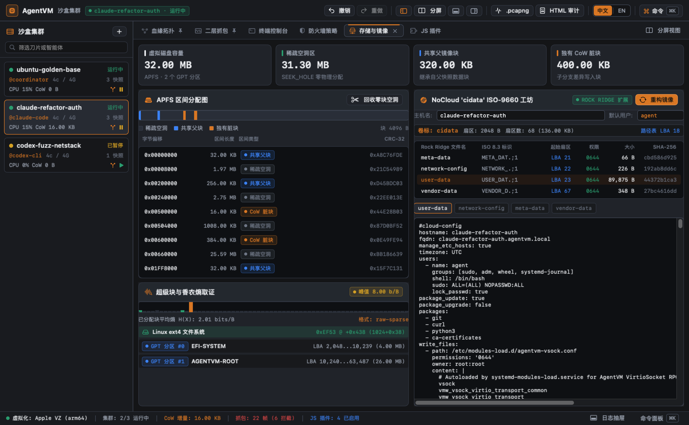

**[English](README.md)** | **简体中文**

# AgentVM `v1.1.0`

**Apple Silicon 原生微虚拟机沙盒、亚 20 毫秒 APFS 写时复制（CoW）即时分叉与二层深度包检测（DPI）安全工作台（`Virtualization.framework` + Swift 6）**

[](https://github.com/zxu756/AgentVM/releases)
[-141517)](https://github.com/zxu756/AgentVM)
[](https://swift.org)
[](README.md)
[](LICENSE)

`AgentVM`（`v1.1.0`）是一款专为 Apple Silicon 打造的工业级本地微虚拟机沙盒与网络安全审计工作台。底层直接构建于 Apple 原生 `Virtualization.framework`、Darwin `clonefile(2)` APFS 写时复制存储原语、支持 TLS 1.3 `ClientHello` SNI 深度包检测的纯 Swift 用户态二层以太网交换机、多路复用 `AVM1` VirtioSocket RPC 通信协议栈，以及带微秒级看门狗的 `JavaScriptCore` 策略沙盒之上。

专为在硬件级隔离的 Linux / macOS 微虚拟机中并行运行自主编码智能体（Claude Code、Codex、Antigravity、Mistral Vibe）而设计：**同时派生 10 条互不干扰的实验分支仅需不到 20 毫秒且初始磁盘额外占用为 0 字节**；每一帧出站以太网报文均被逐字节拆解至 TLS SNI 域名与 DNS 标签；破坏性客户机命令在执行前自动触发 CoW 快照保护；工作台全界面支持无需重启的 **`中文 | EN` 实时双语无缝切换**。


---

## `v1.1.0` 核心升级：全栈原生中英双语工作台与合规档案

- **零重启实时界面语言切换**：支持通过顶部工具栏深色机架石墨黑 + 硬件琥珀金（`#141517` + `#D97724`）**`中文 | EN` 分段切换胶囊**、菜单栏快捷键 `⇧⌘L`（`切换语言 / Toggle Language`）、`⌘K` 模糊命令面板或 `⌘,` 偏好设置即时切换中英文，覆盖所有标签页、机架导航栏、KPI 指标卡、协议拆包树、状态栏与弹窗提示。
- **确定性语言优先级解析**：严格按 CLI 参数 `--lang zh|en` -> 环境变量 `AGENTVM_LANG=zh|en` -> `UserDefaults`（`io.github.zxu756.AgentVM.language`） -> macOS 系统首选语言 `Locale.preferredLanguages.first`（以 `"zh"` 开头自动默认简体中文 `.zhHans`）顺序解析。
- **交互式双语单文件 HTML 安全合规档案**：`agentvm export-html` 导出的独立审计报告（[`docs/demo-agentvm-dossier.html`](docs/demo-agentvm-dossier.html)）内置右上角 `中文 | EN` 切换胶囊，支持 `localStorage` 记忆与浏览器 `navigator.language` 中文环境自动识别。
- **2x Retina 离屏双语截图引擎**：`--export-screenshots <dir> --lang zh|en` 可确定性渲染 `2720 × 1680 px` 视网膜级中英文工作台全景截图。

---

## 核心架构（11 个隔离式 SwiftPM 模块）

| 层级 | 模块 Target | 工程职责范围 |
|---|---|---|
| **L1 基础模型层** | `AgentVMModels` | 强类型标识符、VM / 网卡 / VirtioFS / Cloud-Init 拓扑校验、`AgentVMLocalizer`（`中文` / `EN` 实时双语引擎）、IEEE 802.3 CRC-32、RFC 1071 校验和与边界安全二进制游标 |
| **L2 事务存储层** | `AgentVMStore` | 线程安全 `<SQLite3>` WAL 引擎（含 `v1 -> v4` 模式迁移）、`.agentvm` 包完整性校验器、Command 模式无限撤销/重做（Undo/Redo）控制器、SHA-256 黄金镜像目录、Kahn 拓扑排序与最近公共祖先（LCA）/ 垃圾回收（GC）DAG 查询引擎 |
| **L3 写时复制存储层** | `AgentVMStorageCoW` | Darwin `clonefile(2)` 亚 20ms CoW 即时分叉、`SEEK_HOLE`/`SEEK_DATA` + `F_PUNCHHOLE` 稀疏区段分析器、`AVMPATCH` zlib 二进制差分引擎、纯 Swift ECMA-119 + Rock Ridge `cidata` **ISO-9660 Cloud-Init 构建与解析器**、保护性 MBR + 主备 GPT 分区表与 QCOW2 v3 转换器、ext4 超级块与香农熵取证 |
| **L4 二层交换与 DPI** | `AgentVMNetSwitch` | 基于 `socketpair` 数据报泵送的用户态二层以太网交换机、逐字节 Ethernet II / 802.1Q VLAN / ARP / IPv4 / ICMPv4 / UDP / DHCPv4 / DNS（RFC 1035 防环解析）/ TCP / TLS 1.2 & 1.3 `ClientHello` SNI & ALPN / HTTP 拆包器、关联 DNS-IP 映射与令牌桶限流的有状态出站防火墙、Wireshark `.pcapng` 编解码器与递归下降布尔过滤表达式引擎 |
| **L5 Vsock 与终端层** | `AgentVMVsockRPC` | 24 字节大端序 `AVM1`（`0x41564D31`）多路复用帧协议（含 CRC-32 与 `zlib` 压缩）、基于信用窗口的流控会话管理器、POSIX 本地回环 TCP 端口转发器、完整 VT100/ANSI/xterm 终端屏幕缓冲区，以及交叉验证的 Python 3 `agentvm-guestd` systemd 引导生成器 |
| **L6 安全扩展宿主层** | `AgentVMPluginHost` | 单插件独立隔离的 `JSVirtualMachine` 沙盒（细粒度能力门控 + 微秒级超时熔断看门狗）、4 款内置安全插件（`secret-leak-guard` 密钥防泄漏、`runaway-budget-breaker` 预算熔断、`auto-git-checkpoint` 破坏性命令前自动快照、`iac-compose-bridge` 拓扑桥接）及 `.avm.hcl` / `compose.yaml` 双向编译器 |
| **L7 虚拟化驱动层** | `AgentVMHypervisor` | 原生 `VZVirtualMachine` 生命周期驱动（Linux 内核直启、UEFI NVRAM、Virtio-Block、Virtio-FS、Rosetta x86_64 转译共享、内存气球、Virtio 熵设备、串口控制台、`saveMachineStateTo`/`restoreMachineStateFrom` 内存休眠恢复）+ 确定性混合仿真后端 |
| **L8 命令行与 MCP** | `AgentVMCLIAndMCP` | 15 子命令 `agentvm` 无头 CLI（支持 `--lang zh|en`）、含 9 个工具的 JSON-RPC 2.0 `stdio` Model Context Protocol 服务端，以及通过 Hallmark 审计的双语单文件 HTML 安全合规档案导出器 |
| **L9 工业外壳层** | `AgentVMWorkbenchShell` | 深色机架石墨黑 + 硬件琥珀金（`#141517` + `#D97724`）设计系统、`中文 | EN` 分段胶囊、双栏分屏 / 文档标签停靠控制器、零延迟 `⌘K` 双语子序列模糊命令面板、`⌘,` 多页签偏好设置、左右机架边栏与 4 通道底部抽屉 |
| **L10 工作台视图层** | `AgentVMStudioViews` | 交互式快照与 CoW 分支血统 DAG 画布、Wireshark 级三栏抓包表 + 协议树 + 16 字节同步十六进制转储、VT100 控制台、出站防火墙干跑模拟器、APFS 区段图谱与 ISO-9660 工作台、实时 JS 插件演练场 |
| **L11 统一可执行入口** | `AgentVM` | 单一 Apple Silicon 原生二进制同时承载 SwiftUI macOS 桌面工作台、多子命令无头 CLI、`stdio` MCP 服务端与 `2720 × 1680 px` 2x Retina 离屏截图渲染器 |

---

## 工作台核心界面一览（2x Retina 实机渲染）

### Wireshark 级二层以太网抓包与 16 字节同步十六进制协议拆解器


### APFS 写时复制稀疏区段图谱与纯 Swift NoCloud ISO-9660 注入工作台


### 双栏分屏：L2/L7 出站防火墙模拟器与 JavaScriptCore 安全扩展宿主


---

## 安装与构建

### Homebrew Cask 一键安装（macOS 14+ Apple Silicon）

```bash
brew install --cask zxu756/tap/agentvm
```

### 从源码编译构建

```bash
git clone https://github.com/zxu756/AgentVM.git
cd AgentVM
swift test --no-parallel
./Scripts/build-app.sh
open build/AgentVM.app
```

> **虚拟化权限签名说明**：`Scripts/build-app.sh` 会自动使用 `com.apple.security.virtualization` 权限对 `AgentVM.app`（`v1.1.0`）执行本地 Ad-Hoc 签名，无需付费 Apple Developer 证书即可在 Apple Silicon 上直接启用硬件加速的 `Virtualization.framework`。

---

## CLI 命令行、多语言切换与 MCP 自动化集成

桌面工作台的全部核心能力均可通过 `agentvm` 命令行无头调用：

```bash
# 0. 指定简体中文或英文启动桌面工作台（运行中亦可随时按 Shift+Cmd+L 实时切换）
/Applications/AgentVM.app/Contents/MacOS/AgentVM --lang zh
AGENTVM_LANG=en /Applications/AgentVM.app/Contents/MacOS/AgentVM

# 1. 检测宿主机 Apple Virtualization、APFS clonefile(2) 与 Rosetta Linux 就绪状态
agentvm doctor

# 2. 初始化 .agentvm 工作区包并预置 3 台演示沙盒集群
agentvm init --workspace ./my-fleet.agentvm --seed-demo
agentvm ps

# 3. 为编码智能体派生亚 20ms 的 APFS 写时复制（CoW）隔离分支
agentvm --workspace ./my-fleet.agentvm branch ubuntu-golden-base claude-exp-01 --owner claude-code

# 4. 通过多路复用 AVM1 VirtioSocket 在客户机内执行受安全策略守护的命令
agentvm --workspace ./my-fleet.agentvm exec claude-exp-01 -- uname -a

# 5. 使用布尔过滤表达式检索二层 DPI 抓包记录并导出 Wireshark .pcapng 文件
agentvm --workspace ./my-fleet.agentvm pcap --filter "proto == TLS || verdict == DROP" --export capture.pcapng

# 6. 导出声明式 HCL 拓扑配置或内置中英双语切换的单文件 HTML 合规审计档案
agentvm --workspace ./my-fleet.agentvm export-hcl > fleet.avm.hcl
agentvm --workspace ./my-fleet.agentvm export-html docs/demo-agentvm-dossier.html
```

### 接入内置 MCP 服务端（支持 `Claude Code` / `Codex` / `Antigravity`）

```json
{
  "mcpServers": {
    "agentvm": {
      "command": "/Applications/AgentVM.app/Contents/MacOS/AgentVM",
      "args": ["mcp"]
    }
  }
}
```

---

## 开源许可

本项目基于 [MIT License](LICENSE) 开源发布。
